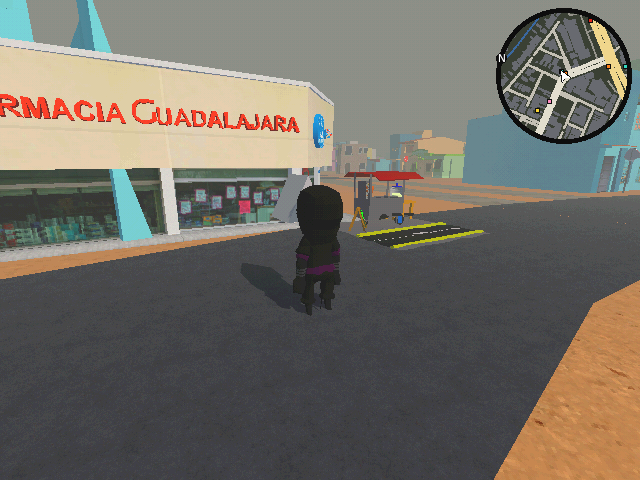
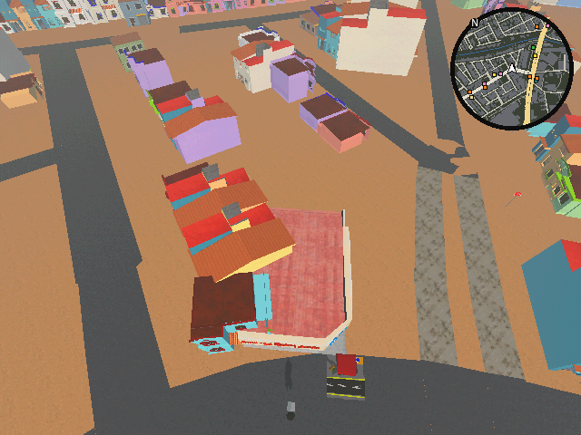
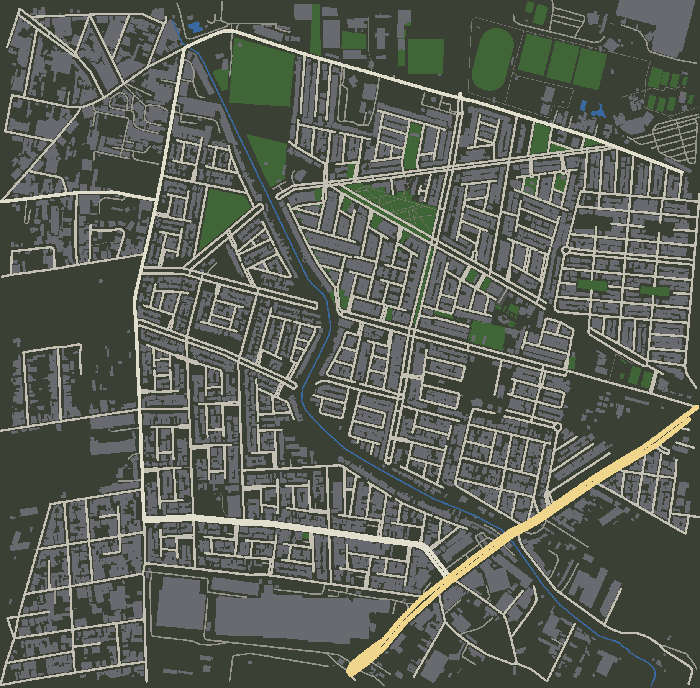

# El mapa real de Zapopan

`scenes/map_test.tscn` es un pedazo real de Zapopan, Jalisco, de ~1.7 × 1.7 km, para recorrerlo a pie o en dron con el look PS1 del juego. Va de **20.606286, −103.423463** a **20.590700, −103.406515** y cubre colonias como Parques de Santa María, Haciendas de San José, Parques del Bosque, Agua Blanca, El Mante y La Palmira.

| A pie | En dron |
|---|---|
|  |  |

La escala es real: 1 unidad de Godot = 1 metro, y el personaje mide 1.74 m.

## Cómo correrlo

```bash
godot --path . scenes/map_test.tscn
```

La primera vez hay que abrir el proyecto en el editor o correr `godot --path . --headless --import` para que Godot importe los modelos. En el editor, `map_test.tscn` sale sin mapa: los cuadros se cargan solo al correr la escena.

### Controles

| Acción | A pie | En dron |
|---|---|---|
| Moverse | WASD / flechas | WASD / flechas (15 m/s, a 30 m de altura) |
| Girar la cámara | Mouse o Q / E | Mouse o Q / E |
| Correr | Shift (10 m/s, 18 m/s corriendo) | Shift (×3) |
| Saltar | Espacio | — |
| Cambiar entre jugador y dron | V | V |

Se arranca a pie, enfrente de una Farmacia Guadalajara con un puesto. Al pasar del dron al jugador, el jugador aterriza justo debajo del dron, en la calle o en una azotea.

## Qué hay en el mapa

- **Calles y edificios**:
  - La geometría sale de [OpenStreetMap](https://www.openstreetmap.org), convertida a 3D con [OSM2World](https://osm2world.org).
  - OSM solo tiene ~970 casas en la zona; el resto sale de [Google Open Buildings](https://sites.research.google/open-buildings/), huellas detectadas por satélite. En total son ~7,900 edificios.
  - Los que no tienen datos salen de 1–2 pisos, con azotea plana y un color de fachada.
- **Casas modelo por colonia**:
  - Unas 6,300 casas modelo de Sketchfab:
    - Parques del Bosque: Casa Semi Residencial y Mexican House 3.
    - Todas las demás colonias: Casa Urbi/Infonavit de 1 y 2 pisos, y Semi Residencial en algunas de 2 pisos.
    - En Agua Blanca Industrial no hay casas modelo: ahí son bodegas.
  - La colonia de cada manzana sale de los negocios del DENUE que hay en ella. Así una manzana nunca mezcla dos colonias.
  - Las casas no se ponen una por cada huella de Google (se enciman entre sí). En cada lado de cada cuadra, donde hay casas, se ponen modelos pegados uno junto a otro, todos a la misma escala. Los huecos de más de 10 m (baldíos, parques) se dejan vacíos y la hilera llega hasta los negocios.
  - Dos casas nunca se enciman por los lados (en la hilera o en una esquina); por atrás, espalda con espalda, sí se pueden encimar.
  - Las fachadas de una cuadra quedan alineadas aunque sean modelos distintos.
  - Cada casa pinta su muro de un color al azar y deja puertas, ventanas y herrería como vienen.
- **Fachadas**: las casas que no son modelo usan un shader que pinta en cada tramo ventanas con herrería, puertas, cortinas metálicas y zaguanes. Las azoteas son de impermeabilizante rojo o losa gris. Las texturas son fotos CC0 de [Poly Haven](https://polyhaven.com) más dibujo propio. El pasto, el asfalto y las banquetas también salen de Poly Haven.
- **Calles, banquetas y camellones**:
  - Cada calle tiene un ancho según su tipo (primaria 14 m, residencial 7 m, privada 6 m...) y banquetas de concreto con guarnición (1.2–2 m). Si las fachadas de la calle quedan más cerca, la banqueta y luego el arroyo se angostan.
  - Las avenidas que OSM traza como dos calles de un sentido llevan banqueta solo por fuera, y entre las dos un camellón de pasto con guarnición, cortado donde una calle lo atraviesa.
- **Árboles y pasto del satélite**:
  - ~1,300 árboles donde el [Canopy Height de Meta/WRI](https://registry.opendata.aws/dataforgood-fb-forests/) (altura de copas a 1 m) ve una copa, con su altura y ancho. Si caen en la calle se recorren a la banqueta; en una casa se quitan.
  - El piso es pasto verde oscuro; donde Sentinel-2 ve verde en lluvias o tierra pelona en secas (~26 % de la zona) es pasto más claro, con manchas secas. Cerca del jugador salen matas de pasto en 3D.
- **Negocios reales**: 147 negocios del [DENUE del INEGI](https://www.inegi.org.mx/app/descarga/?ti=6): tiendas, taquerías, OXXO, farmacias, tortillerías, puestos y una gasolinera.
  - Si hay varios del mismo giro muy juntos, se deja solo uno (40 m; 80 m en tiendas de abarrotes). Las farmacias se dejan todas.
  - Cada tienda ocupa el lote de una casa de su lado de la calle y mira hacia la calle.
  - El DENUE pone algunos negocios a media calle: se recorren a la banqueta más cercana, con la fachada en la orilla de la banqueta, y los puestos van sobre la banqueta con el frente junto a la guarnición.
  - Si el modelo de un negocio es más grande que su lote (una gasolinera, un OXXO), se quitan las casas que quedarían encimadas: el negocio gana.
  - OXXO, una de cada cuatro tiendas (Tienda 3B), Farmacias Guadalajara, Farmacias Similares (kiosco con el Simi bailando; hay 2), puestos y gasolinera usan modelos low-poly de Sketchfab (CC BY).
  - Las demás tiendas de abarrotes, taquerías, tortillerías y farmacias de barrio son locales armados en código, como las tienditas de colonia: muro blanco con rodapié y franja roja o azul (verde las farmacias), el nombre pintado, cortina y mostrador; las taquerías llevan lona y los abarrotes un círculo de refresco sin marca.
- **Deterioro post-apocalíptico** (todo en shaders, sin modelos extra):
  - Un ruido grande en el mapa decide qué tan destruida está cada zona: unas cuadras casi intactas y otras muy dañadas.
  - Muros: pintura deslavada, escurrimientos, mugre abajo, hollín de incendios y aplanado caído que deja ver block o tabique.
  - Las casas sin modelo tienen ventanas rotas o tapiadas con tablas o block, puertas tapiadas y cortinas oxidadas con grafiti. En las casas modelo se rompen los vidrios.
  - Calles con grietas, baches y tierra acumulada; banquetas con losas rotas; más pasto seco.
  - La imagen se ve más desaturada y amarillenta, con las orillas oscuras.
  - `scripts/map/Deterioro.gd` da el mismo deterioro en código (`Deterioro.zona(x, z)`): lo usan las bodegas, y después servirá para que salgan más zombies en las zonas más destruidas.
  - Se ajusta en Proyecto → Configuración → Shader Globals: `deterioro` (máximo, 0–1, ahora 0.8) y `deterioro_escala` (tamaño de las zonas, 150 m). La corrección de color está en el material del nodo `PS1_Postprocess/Dither` de `map_test.tscn`.
- **Bodegas huecas** (89 naves, sobre todo en La Gigantera y El Mante, más las de Agua Blanca Industrial):
  - Salen de los edificios sin nombre de más de 600 m² (en Agua Blanca Industrial, desde 100 m²). Las enormes se parten en varias naves con pasillos, y se recortan para no salirse a la calle.
  - Muros de lámina con óxido, techo de arco con cerchas y piso de concreto con grietas. El frente son vanos del modelo "Industrial Warehouse" de Sketchfab: unos con portón y otros abiertos, por donde se entra caminando.
  - Adentro hay racks, estantes oxidados y cajas (Sketchfab, CC BY), en hileras con una de cada dos quitada para que no se vea tan lleno.
  - Junto a la bodega más grande de La Gigantera, sin vsync: ~200 FPS adentro y ~170 afuera (sin bodegas, ~240 y ~210). Los racks se simplifican al importar porque se repiten cientos de veces; las tarimas se quitaron porque costaban mucho para lo que aportaban.
  - Entre más deterioro en la zona, más portones abiertos, más hoyos en el techo y, a veces, un boquete en un muro lateral.
- **Bardas y mallas** (~31 km), deducidas del mapa porque OSM casi no las trae (solo 16):
  - **Cotos**: un coto es un grupo de calles privadas (`access=private`) o con pluma (`barrier=gate`/`lift_gate`); 52 cotos. Su contorno lleva barda de block o malla ciclónica en la orilla de la banqueta (más malla entre más deterioro). Si una manzana es honda y tiene casas que dan a la calle pública, esa orilla no lleva barda. Las privadas no se rodean de barda.
  - **Baldíos**: tramos de calle de 12 m o más sin nada construido en 15 m de fondo llevan malla al frente. No llevan los que son pasto según el satélite.
  - **Bodegas**: una malla alrededor de las naves de cada predio, a 3 m.
  - Las bardas tienen castillos, grafiti (más entre más deterioro) y boquetes. Los grafitis y la propaganda pintada ("SE VENDE", bailes, fletes...) salen de dos catálogos: cada uno es una imagen al azar de `textures/map/grafitis/` o de `textures/map/propaganda/`. Para agregar diseños basta con poner ahí una imagen (los grafitis con fondo transparente y recortados a lo que ocupan; la propaganda como letrero rectangular, por ejemplo de 128 × 64) y abrir o reimportar el proyecto. Si miden más de 128 px de lado se reducen. La propaganda va grande a media barda y los grafitis encima. Los `grafiti_dibujado_NN.png` y `propaganda_dibujada_NN.png` los genera `make_textures.py`; no se borran los demás.
  - Las mallas tienen agujeros y un portón abierto. Siempre hay por dónde pasar. Todo tiene colisión, menos los huecos.
  - Cada entrada de coto es un acceso: una pluma por carril (poste y brazo caído o roto) y una sola caseta de vigilancia, en la isleta entre carriles si cabe o a un lado. En OSM una entrada suele tener dos carriles y a veces dos líneas de plumas; solo queda la línea más cercana a la calle pública. Los estacionamientos y gasolineras (cotos de puras calles `service`) llevan pluma sin caseta. 117 plumas y 50 casetas.
  - **Alumbrado público**: OSM no trae postes de luz, así que se ponen cada 30 m en la banqueta, junto a la guarnición: en las avenidas alternando de lado (postes de 10 m), en las demás calles de un solo lado (8 m), y en las avenidas con camellón, postes de doble brazo en el camellón. Nunca en una esquina, encima de una casa o pegados a un alto, puesto o pluma (~1,450 postes). Según el deterioro de la zona hay lámparas apagadas, que parpadean, postes chuecos o tirados. La mayoría son de vapor de sodio (naranja) y algunas LED (blancas). De noche (tecla **N** en `map_test.tscn`) brillan la mica y un halo, y las 16 lámparas prendidas más cercanas al jugador alumbran de verdad.
  - Los parques y áreas verdes de OSM nunca llevan barda. Sin costo medible en FPS.
- **Señales de alto** en 1 de cada 20 esquinas, del lado derecho y de cara al tráfico.
- **Minimapa estilo GTA** en la esquina superior derecha:
  - Gira con la cámara y marca al jugador con una flecha, el norte con una N y cada negocio con un cuadrito de color.
  - Colores: rojo OXXO, amarillo tienda, naranja tacos, beige tortillería, turquesa farmacia, verde gasolinera, rosa puesto.
  - En dron se aleja para ver más.
- **Carga por partes**: el mapa está partido en 200 cuadros de 128 m. Solo se cargan los cercanos (~40), en segundo plano. Las tiendas y las casas modelo se cargan igual, por celdas.

<p align="center"></p>

En la laptop de desarrollo (Intel Iris Plus 640) corre a ~150–190 FPS a pie y ~140–160 en dron, sin vsync.

No se usan imágenes ni datos de Google Maps o Street View, porque sus términos lo prohíben. Street View solo sirve como referencia visual para corregir cosas a mano.

## Cómo está hecho

```
data/map/area.osm  ─┐
google_buildings   ─┼─▶ prepare_osm.py ─▶ area_prepared.osm ─▶ OSM2World ─▶ models/zona_mapa.glb
denue_*.json       ─┤        │                                                   │ MapPostImport.gd (materiales PS1, colisiones, cuadros)
casas.json, ...    ─┘        │                                                   ▼
                             │                                   split_cuadros.gd ─▶ resources/map/cuadros/*.scn
                             ├─▶ resources/map/puntos_mapa.json   (tiendas y altos)
                             ├─▶ resources/map/casas_mapa.json    (lotes de casas modelo)
                             ├─▶ resources/map/bodegas_mapa.json  (naves)
                             ├─▶ resources/map/bardas_mapa.json   (bardas, mallas y plumas)
                             ├─▶ resources/map/alumbrado_mapa.json (postes de luz)
                             ├─▶ make_vegetacion.py ─▶ pasto_mascara.png, arboles_mapa.json
fetch_satelite.py ─▶ data/map/satelite_* ─┘   (Canopy Height + Sentinel-2)
                             └─▶ make_minimapa.py ─▶ textures/map/minimapa.png
```

Al correr la escena, cada nodo carga lo suyo alrededor del dron, que cuando no está volando va pegado al jugador:

| Nodo en `map_test.tscn` | Script | Qué hace |
|---|---|---|
| `Mapa` | `scripts/map/MapStreamer.gd` | Carga y descarga los cuadros de `resources/map/cuadros/`. |
| `Puntos` | `scripts/map/MapPuntos.gd` | Pone los negocios y altos con su modelo (`prefabs`), o arma los locales. |
| `Casas` | `scripts/map/MapCasas.gd` | Dibuja las casas modelo con un MultiMesh por celda y les pone colisión. |
| `Bodegas` | `scripts/map/MapBodegas.gd` | Arma las bodegas huecas por celda, en un hilo. |
| `Bardas` | `scripts/map/MapBardas.gd` | Arma bardas, mallas y plumas por celda, en un hilo, con colisión. |
| `Alumbrado` | `scripts/map/MapAlumbrado.gd` | Postes de luz por celda (MultiMesh) con colisión; de noche, halos y hasta 16 luces reales cerca del jugador. |
| `NocheDebug` | `scripts/map/MapNocheDebug.gd` | Noche de prueba con la tecla N (mientras no hay ciclo día/noche). |
| `Arboles` | `scripts/map/MapArboles.gd` | Los árboles del satélite, un MultiMesh por celda, con colisión en el tronco. |
| `Pasto` | `scripts/map/MapPasto.gd` | Matas de pasto 3D a menos de 40 m del jugador; le pone la máscara de pasto al plano `Suelo`. |
| `Dron` | `scripts/map/MapDron.gd` | Modo dron (tecla V). |
| `Minimapa` | `scripts/map/MapMinimapa.gd` | El radar de la esquina. |

Shaders del mapa:
- `ps1_facade`: fachadas de OSM2World.
- `ps1_casa`: casas modelo, con color de muro por casa.
- `ps1_suelo`: piso, pasto (con la máscara del satélite), banquetas, asfalto y empedrado.
- `ps1_arbol`: árboles (atlas de corteza y hojas, verde por árbol).
- `ps1_pasto`: matas de pasto que se mecen y se desvanecen con tramado.
- `minimapa`: el radar.

Todos comparten el vértice PS1 de `ps1_vertex.gdshaderinc` (menos el radar, que es 2D).

## Corregir o agregar cosas a mano

| Archivo | Para qué |
|---|---|
| `data/map/overrides.json` | Cambiar etiquetas de un edificio de OSM, por ejemplo pisos o color: `"way/<id>": {"building:levels": "3"}`. |
| `data/map/casas.json` | Qué modelos de casa van en cada colonia, por número de pisos y con un peso. `"*"` son las demás colonias; `_proporcion` dice qué fracción de casas se cambia. |
| `data/map/colonias.json` | Corregir la colonia de una manzana: `"lat,lon de un punto de la manzana": "COLONIA"`. |
| `data/map/puntos.json` | Agregar tiendas o puestos con `{tipo, nombre, lat, lon}`, o quitar negocios mal ubicados con `"omitir"` (usa el `origen` de `resources/map/puntos_mapa.json`). |
| `scenes/map_test.tscn` → `Puntos` | Qué modelo usa cada giro (`prefabs`), cómo girarlo (`prefab_rotacion`) y cuántos metros de frente tiene (`prefab_ancho`). |
| `scenes/map_test.tscn` → `Casas` | Modelos de casa, escala, color de muro (`muro_key`) y distancias de carga. |
| `scenes/map_test.tscn` → `Minimapa` | Tamaño del radar (`tamano`) y cuánto se ve a pie y en dron (`radio_metros`, `radio_dron`). |
| `scenes/map_test.tscn` → `Dron` / `Player` | Altura y velocidad del dron, si se arranca en dron (`iniciar_en_dron`), y spawn y velocidad del jugador. |

Después de editar `overrides.json`, `puntos.json`, `casas.json` o `colonias.json` hay que regenerar el mapa.

## ¿Por qué `models/zona_mapa.glb` no está en GitHub?

Porque el juego no lo usa. El `.glb` (~22 MB) es un paso intermedio, como un `.o` al compilar: sale de OSM2World y `split_cuadros.gd` lo parte en los cuadros que sí se cargan. Esto es lo que va en git y lo que no:

| Va en git (el juego lo carga) | No va en git (se genera o se baja) |
|---|---|
| `resources/map/cuadros/` (201 cuadros + materiales) | `models/zona_mapa.glb` y su `.import` |
| `resources/map/*.json` (negocios, casas, árboles, máscara de pasto, minimapa) | `tools/map_import/bin/` (OSM2World ~450 MB, venv de Python, caché del satélite) |
| `textures/map/*.png` | `data/map/*_debug.png`, `satelite_rgb.png`, `satelite_chm.png` (imágenes para revisar a ojo) |
| `data/map/` (datos de entrada: OSM, DENUE, Google, satélite ya procesado) | `.godot/` (caché de Godot) |

**Para jugar** basta con clonar, importar una vez y correr la escena:

```bash
git clone https://github.com/Tadeosoto/project-taquito.git && cd project-taquito
godot --path . --headless --import        # o abrir el proyecto en el editor
godot --path . scenes/map_test.tscn
```

**Para cambiar el mapa** (otra zona, correcciones en `overrides.json`, `puntos.json`, `casas.json`, otro modelo de negocio...) sigue la sección de abajo y sube lo que cambió en `resources/map/`, `textures/map/` y `data/map/`. Así tus compañeros ven el mapa nuevo sin regenerar nada. El `.glb` no se sube.

Los cuadros son binarios (`.scn`), así que git no puede mezclar dos versiones. Que regenere el mapa **una persona a la vez** y que los demás hagan `git pull` antes de tocarlo. Si salen conflictos en `resources/map/cuadros/`, no se arreglan a mano: se toma una versión (`git checkout --theirs resources/map/cuadros`) o se regenera.

## Regenerar el mapa

Se necesitan:
- Godot 4.7 como `godot` en el PATH.
- Java, para OSM2World (probado con OpenJDK 27). OSM2World se baja solo la primera vez.
- Python 3.10 o más nuevo.
- ImageMagick 7 (`magick`).

En Arch: `sudo pacman -S jre-openjdk python imagemagick`. En Ubuntu/Debian: `sudo apt install default-jre python3 python3-venv imagemagick`. En Windows conviene WSL.

Solo `fetch_satelite.py` necesita librerías aparte (rasterio, numpy, scipy, en un venv). Sus resultados ya vienen en `data/map/`, así que no hace falta correrlo salvo que cambie la zona.

```bash
bash tools/map_import/fetch_osm.sh                         # OSM de la zona (opcional: ya viene en data/map/)
python3 -I tools/map_import/fetch_google_buildings.py      # casas de Google Open Buildings (opcional: ya viene)
python3 -I tools/map_import/fetch_denue.py                 # negocios y colonias del DENUE (opcional: ya viene)
python3 -m venv tools/map_import/bin/venv && tools/map_import/bin/venv/bin/pip install rasterio numpy scipy
tools/map_import/bin/venv/bin/python -I tools/map_import/fetch_satelite.py  # copas y pasto del satelite (opcional: ya viene, ~10 min)
bash tools/map_import/build_glb.sh                         # prepara el .osm, corre OSM2World y hace el minimapa (~30 s)
rm -f .godot/imported/zona_mapa.glb-* && godot --path . --headless --import
godot --path . --headless -s tools/map_import/split_cuadros.gd   # parte el mapa en resources/map/cuadros/
```

`build_glb.sh` también deja `data/map/colonias_debug.png`, con las manzanas pintadas por colonia, para revisar a ojo cómo quedaron las colonias. Y `data/map/calles_debug.png`: la foto de Sentinel-2 con arroyos, banquetas, casas, pasto, camellones y árboles encima.

Los modelos de Sketchfab ya vienen en `models/`. Para volver a bajarlos se necesita un token de Sketchfab, que nunca se guarda en el repo:

```bash
SKETCHFAB_TOKEN=xxxx python3 -I tools/map_import/fetch_sketchfab.py
```

`CLAUDE.md` tiene los detalles técnicos del pipeline y sus trampas, por ejemplo por qué Godot no reimporta el .glb solo.

## Pendientes

- Pasar las mecánicas de `world.tscn` (NPCs, inventario, objetos) al mapa real.
- Torres de departamentos: el modelo "Edificio multifamiliar" ya está bajado, pero falta ubicar las torres.
- Todos los puestos usan el mismo carrito de comida y las 33 tiendas el mismo modelo.
- Hay un tirón pequeño cuando se carga un cuadro.
- Una manzana central de Parques de Santa María sale enorme, porque un arroyo la deja sin calles que la corten.
- Takis, la moneda de 1 peso y los Jarritos están importados en `models/objetos/` pero todavía no se usan.

## Licencias

Datos de OpenStreetMap (ODbL), Google Open Buildings (CC BY 4.0) e INEGI DENUE; OSM2World (MIT), texturas de Poly Haven (CC0) y modelos de Sketchfab (CC BY). Los autores de cada modelo están en [`CREDITS.md`](../../CREDITS.md).
