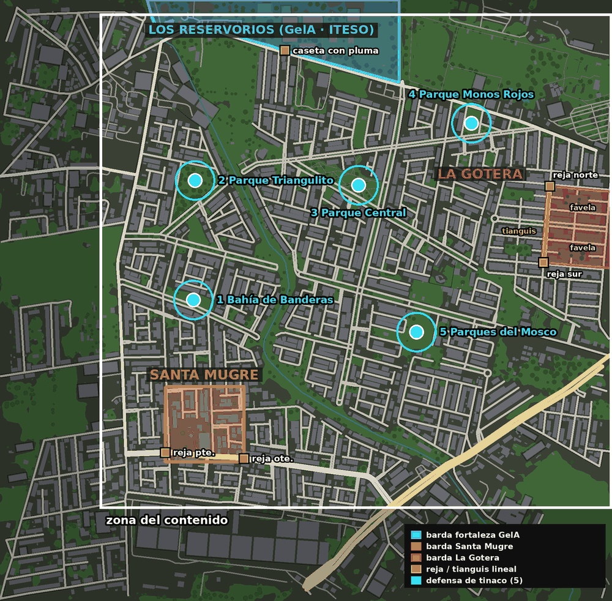

# La zona del contenido: las tres fortalezas y los tinacos

✅ (JJ, 2026-11-12) **El mapa no se recorta**: `map_test` ya está generado y se queda entero (1.83 × 1.80 km). Lo que cambia es **dónde va el contenido del juego**: un rectángulo de **1.53 × 1.48 km** cuyas orillas son las tres fortalezas (GelA arriba, La Gotera a la derecha, Santa Mugre abajo a la izquierda). **Las orillas de afuera**, que de todos modos están muy huecas, se quedan para **cosas escondidas**.

## El cuadro

| | Píxeles del minimapa (1 px = 1 m) | Metros del juego (x, z) |
|---|---|---|
| Esquina noroeste | (297, 40) | (−616, −858) |
| Esquina sureste | (1827, 1520) | (914, 622) |

- Llega hasta la orilla oriente del mapa (ahí está La Gotera) y está corrido 50 m al poniente y 40 m al sur para que la avenida del poniente (la de `a1`–`a5` en `ZonasMapa.gd`) quede dentro.
- Santa Mugre tiene ~100 m de calle afuera de sus dos rejas.

## Las tres fortalezas

| Fortaleza | Dónde (metros del juego) | Entrada |
|---|---|---|
| **Los Reservorios** (GelA) | El polígono del **ITESO** de OSM. Lo que cae fuera del mapa, al norte, es "zona prohibida": no se pisa | Caseta con pluma en la avenida de arriba, ~(−50, −743) |
| **Santa Mugre** | El recorte de Alan: x −420..−185, z 258..482 | Rejas poniente (−420, ~455) y oriente (−185, ~473) |
| **La Gotera** | Haciendas de San José, entre la Av. del Cedro (adentro), Primavera, Nogal y la orilla oriente del mapa; la barda va por las banquetas para no partir casas (x ≈ 705..914, z ≈ −341..−96). Ver [`colonias/la_gotera.md`](colonias/la_gotera.md) | Reja norte (728, −341) y reja sur (710, −114), en la avenida |

## Las cinco defensas del tinaco

Lejos de las rejas, en parques o llanos (JJ, 2026-11-12):

| # | Lugar | Lat, lon | Metros del juego | Reja más cercana |
|---|---|---|---|---|
| 1 | Llano de la calle Bahía de Banderas, Parques de Santa Mugre (se muda del Jardín Imperial) | 20.598503, −103.418214 | (−336, −1) | 464 m |
| 2 | Parque Triangulito | — | (−331, −359) | 818 m |
| 3 | Parque Central (Parques del Mosco) | 20.601584, −103.413479 | (157, −344) | 571 m |
| 4 | Parque "monos rojos" | 20.603248, −103.410248 | (494, −529) | 301 m (reja norte de La Gotera) |
| 5 | Parques del Mosco | 20.597642, −103.411822 | (330, 95) | 433 m |

Hoy `DefensaTinaco` arma su escena alrededor de un solo `CENTRO`, en el Jardín Imperial (163, −515), que **ya no es una de las cinco**. Hace falta una lista de centros (con un `LADO` que quepa en cada parque) y que la misión diga cuál toca.

## Qué implica

1. **No se toca la tubería del mapa** (`area.env`, `prepare_osm.py`, cuadros, minimapa): todo se queda como está.
2. **Contenido nuevo** (misiones, dadores, negocios importantes, marcas, defensas, turbas con guion) va **dentro del cuadro**.
3. **Las orillas** (El Mante Tieso, La Florida Marchita, La Palmada, el sur de El Último Trago y el sureste detrás de la autopista) son para **cosas escondidas**: drops raros, alijos, coleccionables, la entrada a los túneles, alguna cacería. Lo que el canon ya pone ahí se puede quedar ahí como lugar lejano: la planta embotelladora de El Mante, el **pozo de los abuelos de La Palmada** (de donde salen Chava y la camioneta del gremio) y el tianguis nocturno de El Último Trago.
4. **Mapa de papel** (`ZonasMapa.gd`): las nueve zonas siguen. Solo hay que decidir qué es ahora la zona "La Gotera" del sureste, porque la fortaleza se mudó a Haciendas de San Jodido.
5. **Spawn**: el `Player` de `map_test.tscn` está en (203, 651), 29 m al sur del cuadro. Puede quedarse o subir un poco: ya no es obligatorio.
