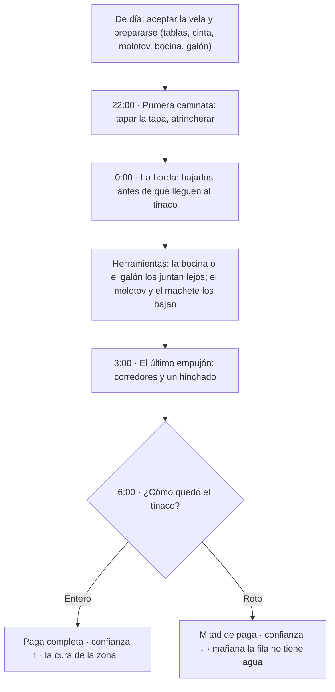

# Guadalajaja — Misiones

> La lista de misiones del juego: la del **piloto**, los **contratos de la noche**, las de **día** y las de **historia**. Documento hermano de [`docs/lore.md`](lore.md) (el mundo), [`docs/especificaciones.md`](especificaciones.md) (las mecánicas) y [`docs/personajes.md`](personajes.md) (quién las da).
>
> Última actualización: 2026-11-12 (bloque L8 del megaplan "Noches de fuera": familia "Defensa externa", guardia de la reja y evento de la reja)

## Cómo usar este documento

| Etiqueta | Significa |
|---|---|
| ✅ **Canon** | Ya está decidido; se puede programar. |
| 💡 **Propuesta** | Idea abierta; se puede cortar o cambiar. |
| 🧱 **Ya existe** | Hay algo en el repo que se puede reusar. |

**Regla de toda misión:** dice **quién la da**, **qué se hace**, **cuánto paga**, **qué riesgo tiene** y **qué sistema reusa**. Si no reusa nada, es trabajo L y hay que pensarlo dos veces.

### Índice

- [0. El piloto: defender el tinaco comunitario](#0-el-piloto-defender-el-tinaco-comunitario)
- [1. Cómo se juegan](#1-cómo-se-juegan)
- [2. Los contratos de la noche](#2-los-contratos-de-la-noche)
- [3. Las misiones de día](#3-las-misiones-de-día)
- [Las misiones de fuera](#las-misiones-de-fuera-megaplan-noches-de-fuera-l9-2026-11-12)
- [4. Las misiones de historia](#4-las-misiones-de-historia)
- [5. El sistema de misiones](#5-el-sistema-de-misiones)
- [6. Cómo se agrega una misión](#6-cómo-se-agrega-una-misión)
- [7. Prioridad](#7-prioridad)
- [8. Preguntas abiertas](#8-preguntas-abiertas)

---

## 0. El piloto: defender el tinaco comunitario

✅ **La misión del piloto.** Es la que se programa primero, la que se enseña y la que decide si el juego jala. Reúne todo el núcleo: la noche, los zombis, el agua, el tinaco, los pesos y el barrio.

> ✅ **Replanteo del 2026-11-12 (megaplan "Noches de fuera"):** la antigua *Vela* es ahora **Defender el tinaco**, la primera mitad de la familia **"Defensa externa"** (la otra es [Defender la camioneta](#defender-la-camioneta)). Se juega **fuera de las fortalezas**, como parte del reparto de agua de noche del gremio ([lore §14](lore.md#el-agua-de-noche-el-negocio-del-gremio)), no en el tinaco de Santa Mugre: ese pasa a ser el [evento de la reja](#el-evento-de-la-reja-no-es-misión), que no se acepta. Las oleadas, el tinaco con vida y la escena de prueba (`defensa_tinaco.tscn`) siguen igual.

| | |
|---|---|
| **Nombre** | Defender el tinaco (antes, Vela del tinaco) |
| **Quién la da** | **Chava** (el pozo, el gremio) o **Gabriel** (la cuadrilla y la ficha), por turnos |
| **Dónde** | Una **barricada con un tinaco y bocinas** en un baldío o parque **fuera de las casas y de las fortalezas** (La Palmada, Parques del Mosco y otras colonias de fuera) |
| **Cuándo** | Noche completa, hasta el amanecer |
| **Duración** | 8 minutos de juego (la noche entera). En la prueba (`scenes/defensa_tinaco.tscn`) son 3:30 min (`duracion_noche`; antes 6, se hacía larga), por decisión de JJ |
| **Paga** | Pesos + un galón de agua + la **ficha** sellada + confianza del barrio |
| **Riesgo** | Alto: si el tinaco se rompe, se pierde el agua del barrio |
| **Reusa** | `Zombis.gd` (director y oleadas), `Refugio.gd` (barricadas), el tinaco como objetivo de vida, `CargaCuadro` |

### La noche, en tres oleadas

1. **22:00 — la primera caminata.** Pocos zombis, lentos. Sirven de tutorial: aprende a pegar, a atrincherar y a tapar la tapa.
2. **0:00 — la horda.** Llega el grupo grande. Hay que bajarlos antes de que lleguen al tinaco: la **bocina** y el **galón** sirven para juntarlos lejos y pegarles (o quemarlos) en bola.
3. **3:00 — el último empujón.** Los más rápidos (corredores) y un hinchado. Si el jugador aguantó, el tinaco está a punto.
4. **6:00 — el amanecer.** Los zombis se caen. El barrio abre la puerta y paga.

En la prueba ya no hay pausas largas entre oleadas (comentarios de Alan y JJ, 2026-11-03). Salen grupos de un mismo lado que tardan unos 10 s en llegar: ese rato es de la pistola, y al llegar se acaban con el machete. El siguiente sale cuando del anterior queda uno, así llega mientras terminas. Los grupos crecen con la hora: el más grande a medianoche, corredores a las 3:00 y el último a las 5:00 (`scripts/defensa/Hordas.gd`, `GRUPOS`). Por dónde vienen no se avisa con texto.

En la escena de prueba las noches se **encadenan** a través del **refugio** (safehouse en modo carrera): al amanecer, **Siguiente** vuelve al refugio y la flecha inicia la siguiente (más difícil); **Reintentar la noche** vuelve al refugio con la misma noche y una ayuda de dinero. En el refugio están todas las tiendas físicas y el **punto de mejoras** (todo en pesos); la defensa directa (`defensa_tinaco.tscn`) es el **godmode** de mecánicas, con todo al máximo e ítems infinitos. La misión de diseño sigue siendo una noche; esto es el banco de pruebas (`docs/pruebas-balance.md`).

### Si te desmayas

Desmayarte **acaba la misión**, sin paga, igual que si rompen el tinaco (decisión de JJ, 2026-11-03). En la prueba se puede reintentar esa misma noche desde el menú. Alan propuso arrastrarse por el piso y revivir con un caldo de camarón o una torta ahogada, perdiendo vida máxima en cada reanimación, pensando en un coop donde los jugadores se revivan entre sí. Queda pendiente para el coop: ahí, el que se desmaya sale de la misión y espera a ver si sus compañeros aguantan.

### El tinaco

- Tiene **100 de vida** (como el jugador). En la prueba tiene 300, como el tinaco del refugio: cada zombi le quita 2 por segundo y con 100 una horda lo rompía en segundos.
- Los zombis lo **muerden, lo empujan y lo trepan**; cada mordida baja vida.
- El jugador lo **repara** con tablas y cinta (sube vida, cuesta material).
- Si llega a **0**, el agua se riega, el barrio pierde la tanda y **no se paga nada**: la noche se corta y amanece. Con media paga convenía entrar y dejarse perder (decisión de JJ, cambia lo que decía aquí antes).
- La tapa es el punto débil: hay que **cerrarla** entre oleada y oleada.

### Lo que el jugador lleva

- **Tablas y cinta** (barricadas y reparación).
- **Machete** (arma inicial).
- **Molotov** (para la horda).
- **Bocina** (los atrae a un punto lejos del tinaco para pelearlos juntos; luego explota, o no).
- **Lámpara** (para ver y para que lo vean).
- **Un galón de agua** (para beber, o de cebo: lo sueltas y se juntan a beberlo, y ahí les pegas).

### Por qué es el piloto

- Usa el **núcleo** del juego: noche, zombis, tinaco, agua y pesos.
- Es **repetible**: cada noche cambia el número de zombis y la zona.
- Es **corto**: 8 minutos.
- Es **medible**: si el jugador se divierte y aguanta, el resto del juego se sostiene.
- Es **barato**: no necesita mapa nuevo, solo el tinaco comunitario y el director de zombis.

### La ficha completa

💡 Diseño hecho con `/game-quest` (2026-11-02). Lo de arriba sigue siendo el piloto; esto le pone las herramientas, las consecuencias y lo que pasa si falla.

**Gancho:** *"El tinaco es del barrio y esta noche no lo cuida nadie. Gabriel paga, la colonia pone el agua y tú pones el machete."*

**Tipo:** repetible, de proteger. **El objetivo es uno: que ningún zombi llegue al tinaco, y eso se logra matándolos.** No tiene caminos alternativos y no le hacen falta: es el contrato que se repite cada noche, y la variedad sale de la zona, de los zombis y de cómo usa el jugador sus herramientas. Se puede tomar cada noche; cambian la zona, los zombis y el escalón del régimen.

**Quién la da:** ✅ (2026-11-12) **Chava**, en el pozo de La Palmada (de ahí sale el agua del reparto), o **Gabriel** "el Patrón" Hinojosa (la cuadrilla), **en Santa Mugre** (✅ 2026-11-12, donde está el jugador), que sella la ficha. Se acepta de día, antes de las 19:00.

**Dónde:** la barricada se monta en un sitio **fuera de las casas y de las fortalezas**: **La Palmada**, **Parques del Mosco** u otra colonia de fuera. El **tinaco comunitario de Santa Mugre** ya no es de esta misión (es el [evento de la reja](#el-evento-de-la-reja-no-es-misión)). La zona decide cuántos zombis salen (`Zombis.maximo()` con el índice) y cuánto paga. Esta misión **protege a la gente de fuera**: mientras los zombis están ocupados en el tinaco, el agua limpia se reparte a las casas que la necesitan.

**Objetivos:**

1. **Prepararse de día** (obligatorio): comprar o fabricar tablas, cinta, molotov (botella + trapo + gasolina) y bocina; llevar un galón.
2. **22:00, la primera caminata** (obligatorio): pocos flacos, lentos. Enseña a pegar, a atrincherar y a **cerrar la tapa** entre oleadas.
3. **0:00, la horda** (obligatorio): el grupo grande. Hay que **bajarlos antes de que lleguen al tinaco**. Las herramientas ayudan a pelear:
   - **La bocina** los atrae a todos a un punto lejos del tinaco; ahí se pelean juntos. Luego explota (o no).
   - **El galón**, soltado de cebo, los junta a beber (beben y no se llenan, lore regla 16): un blanco quieto para el machete o el molotov.
   - **El molotov** quema a los que están juntos; **las tablas** cierran el paso y los hacen llegar por donde los esperas.
4. **3:00, el último empujón** (obligatorio): corredores y un hinchado. Si el jugador aguantó, el tinaco está a punto.
5. **6:00, el amanecer**: se cobra según cómo quedó el tinaco.

**Paga** (sin validar con el balance):

- **Pesos:** 200 (La Palmada), 250 (Parques del Mosco); 💡 150 para una colonia de fuera más tranquila (antes era Santa Mugre, que ya no entra aquí). +25 % por cada escalón del régimen de la zona, porque hay más riesgo. Coincide con la tabla de contratos (150-250). **Además, mejoras del personaje** (`docs/mejoras.md`), como en el resto del reparto de noche.
- **Objetos:** 1 galón (35) y la **ficha sellada** de la cuadrilla.
- **Confianza** de la zona: sube si el tinaco queda entero; baja si se rompe.

**Qué cambia en el mundo** (lore §17, el estado del mundo):

| Resultado | Cambia |
|---|---|
| Tinaco entero | Confianza ↑; **cura ↑** (el agua llega a las casas); al otro día la fila del tinaco tiene agua y chisme |
| Tinaco roto | Confianza ↓; la fila está vacía; un bark: *"¿Y el que cuidaba?"* |

**Requiere:** nada. Es el piloto y la primera que se aprende.

**Si falla:** si el tinaco llega a 0, el agua se riega y se cobra la mitad. Si el jugador muere, pierde la paga y reaparece en el refugio (§1); el tinaco aguanta solo lo que le quede. Si abandona la vela, no cobra y la confianza baja.

**Reusa:** `Zombis.gd` (oleadas y `maximo()`), `Refugio.gd` y `EntradaRefugio.gd` (barricadas y el tinaco con vida), `Ciclo.gd` (las horas). **Falta:** los tipos corredor e hinchado (hoy solo hay `zombie_gordo`), la bocina como objeto, la lámpara (sin modelo, `items.md` §8) y el estado del mundo (lore §21).

> **Ojo:** el piloto es **una misión**, no la partida de 3 noches. La partida de 3 noches (`Partida.gd`) es un **modo reto** aparte, con su jefe (que era alguien: ver lore §8) y su tinaco del refugio. El piloto es la versión repetible y pública.

---

## 1. Cómo se juegan

- **De día** se acepta el contrato, se compra, se repara y se duerme.
- **De noche** se sale a cumplirlo; el mundo está oscuro, los zombis salen y las tiendas están cerradas.
- **Los contratos** llegan por el **celular** o por la **cuadrilla**; se aceptan antes de las 19:00.
- **La paga** es en pesos; el agua es un extra.
- **Si el jugador muere** (o se le llena la sed), pierde el botín y la paga del contrato; reaparece en el refugio.
- **Si el contrato falla** (se rompe el tinaco, se pierde el paquete, se muere el cliente), cobra la mitad o nada, y el barrio lo recuerda.

---

## 2. Los contratos de la noche

| Contrato | Quién | Qué se hace | Paga | Riesgo | Reusa | Prog. |
|---|---|---|---|---|---|---|
| **Defender el tinaco** (antes Vela) | Chava, Gabriel (la cuadrilla) | Barricada con tinaco y bocinas fuera de las fortalezas hasta el amanecer, mientras se reparte el agua | Pesos + mejoras + ficha | Una horda numerosa y continua | Tinaco, Refugio, Zombis | M |
| **Defender la camioneta** | Chava, Nacho (el gremio) | Proteger la camioneta del gremio y a Nacho en una ruta de entregas | Pesos por entrega + mejoras | Zombis y, al amanecer, los blancos | Zombis, Misiones, ESCOLTAR (S2) | L |
| **Guardia de la reja** | La parroquia (Chuy, Karla) | Defender una reja de Santa Mugre un rato de noche; recurrente y voluntaria | Pesos | Una horda en la reja | Zombis, rejas | M |
| **Reparto clandestino** | La cuadrilla, un cliente | Llevar agua filtrada (ilegal) del tinaco, el pozo o la capilla al domicilio | Pesos | Los zombis y los blancos | WorldItem, Misiones | S |
| **Recolección** | La cuadrilla, un comprador | Juntar el botín de los muertos en una bodega o una calle | Pesos | Más zombis, las camadas | Botín, Zombis | S |
| **Encargo** | Una señora, el cura | Llevar algo (o a alguien) de un punto a otro | Pesos | La caminata | Seguir, Misiones | S |
| **Cacería** | La colonia, la iglesia | Bajar al zombi que se comió a alguien | Pesos/objeto | Alto | Zombis, Misiones | M |

💡 **Cuánto paga cada contrato** (sin validar con el balance; referencia: galón 35, tacos 45, botín 5-60 por zombi, botiquín 120). La noche paga el triple que el día, y la paga sube con el escalón del régimen de la zona (más riesgo, más pesos).

| Contrato | Paga | Extra |
|---|---|---|
| Defender el tinaco | 150-250 | 1 galón + la ficha sellada + mejoras; si cae el tinaco, nada |
| Defender la camioneta | 60-100 por entrega | Mejoras; sube la cura de la zona; si cae Nacho, la misión falla |
| Guardia de la reja | 💡 80-120 | Baja el desgaste de la reja (menos riesgo del evento) |
| Reparto clandestino | 60-100 por entrega | Sube la cura de la zona |
| Recolección | 30-50 + lo que encuentres | — |
| Encargo | 40-80 | Sube la confianza |
| Cacería | 200-300 o un objeto | El oficio del zombi dice qué suelta |

### Defensa externa (antes, la Vela)

✅ (2026-11-12) La familia principal de contratos de noche. Tiene dos formas, las dos **fuera de las fortalezas**, las dos al servicio del reparto de agua limpia del gremio ([lore §14](lore.md#el-agua-de-noche-el-negocio-del-gremio)). **Quién da:** Chava (el pozo) y Gabriel (la ficha). **De dónde sale el agua:** el pozo de Chava, en La Palmada. **Por qué de noche:** de día la policía (los blancos) dispara a quien reparte agua. **Amanecer:** si te amanece y te ven con el tambo, disparan.

#### Defender el tinaco

El contrato de siempre, ya con su lugar en el mundo: [el piloto](#0-el-piloto-defender-el-tinaco-comunitario). ✅ (2026-11-12, M1, con JJ) **Hay cinco tinacos en el mapa**, uno en cada parque o llano (`SitiosTinaco.gd`, `docs/mapa/zona-enfoque.md`), y **Chava está parado afuera de cada uno**: **de día** te ofrece el contrato ahí mismo; al aceptar **se hace de noche de golpe** y empieza la defensa de ESE tinaco (la pantalla se corta, 1.4 s después de aceptar). Cada tinaco tiene su nivel: **los dos más cerca de Santa Mugre son los más fáciles** y se complican conforme te alejas, y la paga sube igual: Bahía de Banderas (nivel 1, modo fácil, $150), Parques del Mosco (2, fácil ×1.2, $175), Parque Triangulito (3, medio, $200), Parque Central (4, medio ×1.2, $225) y Monos Rojos (5, difícil, $250); más el galón de agua. Una por día (como todas): hecha una, los demás Chavas se despiden. Si pierdes, la misión sigue y la flecha te lleva de vuelta a ese mismo tinaco. Montas una **barricada con un tinaco y bocinas** en un sitio fuera de las casas, la horda llega al agua y al sonido, y mientras están ocupados **se reparte el agua** a las casas de fuera. Se puede hacer **quedándote en la barricada** mientras otro reparte, o **repartiendo tú por tandas**.

#### Defender la camioneta

✅ (2026-11-12) **Quién da:** Chava, con Nacho al volante. **Qué se hace:** la camioneta del gremio sale del pozo de La Palmada con garrafones y recorre una ruta de **tres a cinco entregas** a casas de fuera de las fortalezas. En cada parada Nacho baja el agua (unos 20 a 30 s, 💡) y **tú sostienes a los zombis** que llegan por el agua y el ruido. **Nacho** va contigo: maneja, no pelea ("nunca se queda a pelear"); si él **cae**, la misión falla. Si **la camioneta se rompe** (💡 tiene vida, como el tinaco), también. **Paga:** 60-100 por entrega + mejoras, y sube la cura de la zona; si te amanece en la ruta, los blancos disparan. **Riesgo:** zombis continuos (menos que en la defensa del tinaco de la fortaleza) y policías al amanecer. **Reusa:** `Zombis`, `Misiones`; **necesita** los pasos nuevos DEFENDER, ESCOLTAR y LLEVAR_CARGA (S2). Tamaño **L**.

### Guardia de la reja

✅ (2026-11-11 y 2026-11-12) **Quién da:** la parroquia (el padre Chuy o Karla). **Dónde:** una de las **dos rejas** de Santa Mugre, la poniente (-420, ~455) o la oriente (-185, ~473). **Qué se hace:** defender la reja un turno de noche; llegan zombis atraídos por el agua del tinaco, sin llegar al nivel del evento. **Es recurrente y voluntaria** (no es la defensa del tinaco de la fortaleza, que no se acepta). **Paga:** 💡 80-120 pesos. **Qué cambia:** cada guardia **baja el desgaste de la reja** (ver abajo): cuantas más haces, menos probable es el evento. **Reusa:** `Zombis`, el código de las rejas de la rama `rejas-avenida-santa-mugre`.

### El evento de la reja (no es misión)

✅ (2026-11-11) **No se acepta como contrato** (y, ver abajo, solo se paga si ganas). Una noche **al azar** la reja de Santa Mugre falla, se meten zombis, cae la noche y te avisan: *"corre al tinaco, se metieron los zombis"*. Hay que **defender el tinaco de la plaza** (el tinaco manchado, el del culto), que es la escena de prueba actual (`defensa_tinaco.tscn`).

✅ **Por qué falla (2026-11-12): descuido, y tú influyes.** La reja tiene un **desgaste** (0 a 1) que **sube cada noche** y **baja con cada guardia de la reja** que cumples. La **probabilidad** de que falle esa noche depende del desgaste: con la reja cuidada es baja, con la reja olvidada es alta. La noche sigue siendo al azar, pero el jugador puede evitarla.

✅ **Solo si estás dentro (2026-11-12).** La reja **solo falla si estás dentro de Santa Mugre** cuando cae la noche. Si pasas la noche fuera, no hay evento.

✅ **Muy esporádico (2026-11-12).** La defensa de este tinaco **debe ser muy rara**: es un susto, no la rutina (la rutina es la defensa externa). 💡 Primeros números para probar (`docs/pruebas-balance.md`): el desgaste sube +0.05 por noche y baja −0.25 por guardia; probabilidad = desgaste ÷ 3, mínimo 2 %; y **nunca dos noches seguidas** (tras un evento, el desgaste vuelve a 0 y hay un enfriamiento de varias noches). Con la reja descuidada debería pasar una vez cada varias noches, no cada una.

✅ **Si pierdes el tinaco, pierdes y puedes reintentar tres veces (2026-11-12).** Si el tinaco llega a 0 **pierdes**, y el juego te da la opción de **intentarlo de nuevo, hasta tres reintentos**. **La dificultad va de acuerdo al progreso del juego** (tus armas, tus mejoras, la noche en que vas), así que el evento **siempre es defendible**: no hay una noche imposible. ✅ **Además, cada reintento la baja un poco** respecto a esa dificultad base. 💡 Cuánto baja cada reintento se prueba con el balance (`docs/pruebas-balance.md`).

✅ **Qué es el tinaco (2026-11-12).** El tinaco de la plaza se llena de **"agua bendita" del templo** (la que el padre Chuy saca del pozo y filtra). **La Virgen era una manifestación de esa agua bendita**: lo que la colonia venera es el agua, vista como silueta en la mancha.

✅ **Si dejas que se pierda, se sustituye (2026-11-12).** Si **gastas los reintentos o decides no reintentar** y dejas que el tinaco se pierda, **lo sustituyen por uno nuevo y ya no hay altar ni Virgen manchada**. **El altar** aquí es **la ofrenda y las velas bajo la silueta de la Virgen** en la plaza, no el del templo: el pozo, la puerta bajo el altar del templo y el secreto de Chuy no se tocan. El culto pierde su símbolo visible, para siempre. Es consecuencia de lo que haces, no un castigo automático. ✅ **Cómo reacciona Santa Mugre:** **se ponen tristes** (Chuy y los fieles; sin castigo mecánico, solo duelo en los barks y en la plaza). 💡 Por decidir si el agua bendita sigue saliendo del templo igual (lo más sencillo es que sí).

✅ **Si ganas, te dan una paga en dinero (2026-11-12).** El evento no es un contrato y no tiene paga fija, pero **si defiendes el tinaco, te pagan en pesos**. ✅ **Paga el padre (Chuy).** 💡 **El monto se decide después, con el balance económico** (`docs/mejoras.md` y `docs/pruebas-balance.md`); referencia: la defensa externa paga 150-250.

### Reparto clandestino

El jugador lleva agua filtrada del tinaco comunitario a un cliente. Los **zombis huelen el agua** y la siguen; los **blancos** pueden clausurar la entrega. El paquete es frágil: si lo suelta, se riega.

### Recolección

El jugador entra a una **bodega abandonada** (de día) o a una calle donde cayeron muertos (de noche) a juntar pesos, herramientas y lo que traían. Las **camadas** duermen ahí: hay que entrar sin despertarlas.

### Encargo

Una vecina, el cura o la cuadrilla piden llevar algo (medicinas, una carta, un garrafón) o acompañar a alguien. La caminata puede cruzarse.

### Cacería

La colonia o la iglesia pagan por un zombi concreto: el que se comió a alguien, el que ronda una escuela. El jugador sigue las pistas, lo encuentra y lo baja. La paga es en pesos o en un objeto.

---

## 3. Las misiones de día

| Misión | Quién | Qué se hace | Paga | Reusa | Prog. |
|---|---|---|---|---|---|
| **Transportar droga** | Los Gotera | Llevar un paquete de A a B (de noche, pero se prepara de día) | Pesos/agua | Misiones | S |
| **Transportar algo** | Una tienda, una señora | Llevar un objeto frágil de día, sin correr | Pesos | Misiones | S |
| **Encontrar cosas** | Un vecino, el cura | Buscar N objetos en el mapa y volver | Objeto | WorldItem | S |
| **Corretear a alguien** | Un cliente | Alcanzar a un NPC que huye por una ruta | Pesos | NPC, Misiones | M |
| **Botarga de la Gota** | Nadie: es un disfraz | Ponerte la botarga; los NPCs te siguen y bailan | Objeto especial | `simi_botarga.scn` | S-M |
| **Tiro al blanco** | El barrio, una feria | Caguamas en una barda o patitos en una feria | Pesos/munición | Física, Misiones | S |
| **Sacar dinero de máquinas** | Nadie | Romper una maquinita sin que te vea el encargado | Pesos | `tragamonedas.gd` | S-M |
| **Manifestación** | El comité del barrio | Unirte a una marcha por el agua; llegan policías | Pesos/agua | Multitud, IA | L |
| **Rescatar sobreviviente** | Un vecino | Sacar a alguien atrapado y llevarlo al refugio | Pesos | Seguir | S |
| **Acompañar a alguien** | La cuadrilla | Llevarlo de un punto a otro sin que la caminata lo alcance | Pesos | Seguir | S |
| **Defender el puesto** | El taquero | Aguantar 2 minutos de zombis mientras cierra | Pesos/tacos | Zombis | S |
| **Muestras de agua** | El científico | Llevarle agua de 3 llaves o charcos | Objeto | WorldItem | S |
| **Limpiar una camada** | La cuadrilla | Entrar de día a una bodega y bajar a los zombis dormidos | Pesos | Zombis, Bodegas | M |
| **Carrera** | El barrio | Checkpoints por la colonia, a pie o en carrito | Pesos | Misiones | S |
| **Pintar bardas** | La cuadrilla | Grafitear N bardas marcadas | Pesos | `Calcomanias.gd` | S |
| **Cocinar tacos** | El taquero | Minijuego de pedidos en el puesto | Pesos/tacos | UI | M |
| **Buscar al perro** | Una señora | Seguir ladridos y devolver al perro | Objeto | Seguir | S |
| **Encargo de compras** | Cualquiera | Comprar una lista en el OXXO y entregarla | Pesos | Tiendas | S |
| **Cooperativas** | La cuadrilla | Una persona carga, la otra defiende | Pesos | Multijugador | M |

**Tiro al blanco**, ideas concretas: (a) caguamas vacías sobre una barda con resortera o pistola, puntos por tiempo; (b) puesto de feria con patitos; (c) zombis "de práctica" atados. La (a) es la más fácil.

---

## Las misiones de fuera (megaplan "Noches de fuera", L9, 2026-11-12)

✅ Las misiones que salen de Santa Mugre hacia **afuera de las fortalezas**, con quién da, dónde, objetivo, riesgo y paga. **Regla de dónde viven los dadores:** casi todos los NPC de fuera están bajo Serenol y **no dan misiones**; por eso las dan el gremio (Chava, **Gabriel en Santa Mugre**, y un miembro del gremio en La Gotera), la parroquia (Karla, Chuy), Sofía, el Güero y Nava. **Regla de distancia:** todo lo de la primera tanda a ≤ ~250 m de una reja (ver `docs/plan-noche.md`, "Viabilidad a pie"). Las pagas son 💡 y se ajustan con el balance económico.

| Misión | Quién da | Dónde | Objetivo | Riesgo | Paga | Prog. |
|---|---|---|---|---|---|---|
| **Al médico** | Karla (parroquia) | Santa Mugre → una casa con cruz verde | Llevar a un fiel mordido al médico sin que lo alcancen | La caminata; si muere, falla | 💡 80-120 + confianza de la parroquia | M |
| **Las piezas de la antena** (1.ª de 2) | Sofía | Fuera, ≤250 m de una reja | Encontrar las piezas (tubos, cable, repetidor) | Zombis | 💡 pesos + desbloquea la 2.ª | S |
| **Subir la antena** (2.ª de 2) | Sofía | Una torre de luz (`power=tower`) | Defender el pie de la torre mientras alguien sube | Una horda por el ruido | 💡 pesos; la radio llega más lejos | M |
| **El Decreto 47** (H4) | El Güero o Sofía | La bodega de GelA cerca de la reja poniente (-333, 645) | Sacar el expediente y la hoja de conteo | Camadas dormidas; los zombis | Copias: 200 (A) | M |
| **Reparto** | Chava, Gabriel o el gremio de La Gotera | De la casa de Chava / de Santa Mugre a casas de fuera | Llevar agua limpia a pie antes del amanecer | Zombis; los blancos al amanecer | 💡 60-100 por entrega | S |
| **La hija de Nava** | El Inspector Nava | De noche, entre los zombis de fuera | Encontrar a su hija por la ropa y llevarlo a ella | La horda; que alguien la mate | Paga igual, antes de salir | L |

### Al médico

✅ **Da:** Karla, la mano derecha de la parroquia. **Qué se hace:** un fiel salió herido o mordido y la parroquia no puede curarlo; hay que llevarlo de noche a una **casa con cruz verde** (clínica clandestina, fuera de la reja). El fiel **te sigue**, camina más lento que tú y puede morir. **Repetible:** cada vez es un herido distinto. **Si muere:** falla, no hay paga y la parroquia se pone triste. **Reusa:** `Seguir` y ESCOLTAR (S2). ✅ **El médico es anónimo (2026-11-12):** no sale ni habla; **solo dejas al enfermo en su enfermería** (la casa con cruz verde) y la misión termina. Hay varias clínicas (una casa con cruz verde por colonia cercana). 💡 Por medir: cuáles quedan a ≤250 m de una reja.

### Las piezas de la antena y Subir la antena (cadena)

✅ **Cadena de dos:** la segunda no se abre sin la primera. **Da:** Sofía (su taller, dentro de Santa Mugre; transmite de noche). **1. Las piezas:** encuentra N piezas sueltas (tubos, cable, un repetidor) en sitios de fuera; es un `recoger` con zombis cerca. **2. Subir la antena:** en una **torre de luz** (hay 32 en el mapa, `power=tower`), **Sofía sube** (✅ 2026-11-12; tiene manos de soldador) y **tú defiendes el pie de la torre** mientras sube y la instala. El ruido de la instalación atrae a la horda; el tiempo de subida (💡 60 a 90 s) es el que hay que aguantar. **Qué cambia:** la señal de Sofía llega más lejos (💡 alcance de su radio, y de ahí A3 "La verdad"). **Reusa:** el paso DEFENDER (S2), el sistema de oleadas. ✅ **Si no hay torre de luz a ≤250 m de una reja, se coloca una en un lugar conveniente** (2026-11-12): se agrega al mapa una torre junto a la reja, sin depender del OSM. 💡 Por medir: qué torres reales ya quedan cerca.

### El Decreto 47 (H4 actualizada)

✅ **Da:** el Güero (el empleado del palacio, que vende copias) o Sofía. **Dónde:** la **bodega de GelA cerca de la reja poniente**, en (-333, 645), a unos 209 m: la oficina de GelA de fuera. **Qué se hace:** entrar de noche y sacar el **expediente del Decreto 47 y la hoja de conteo**. **Dos caminos:** (A) el Güero te vende la llave de la bodega y la caja donde están, y tú los sacas; (B) entras sin él, forzando la bodega. **Riesgo:** las **camadas** que duermen adentro y los zombis de la calle; de noche no hay blancos (el Estado se retira). **Qué cambia:** la hoja de conteo (los nombres son los de la lista de Marisol); **Buenrostro empieza a buscar al Güero**, y como vive en la fortaleza GelA, ya no tiene que salir a hacerlo. **Reusa:** `MapBodegas`, `WorldItem`, camadas.

### Reparto

✅ **Quién da (2026-11-12):** **Chava, desde su casa** en La Palmada (agua limpia de su pozo); **Gabriel**, que **convenientemente está en Santa Mugre**, donde empieza el jugador (reparte la ficha y los contratos); y **un miembro del gremio en La Gotera**. **Dos formas:** (1) **sales desde el pozo de Chava** a casas de fuera de las fortalezas; (2) **sales desde la fortaleza llevando agua hacia afuera** (la bendita de Santa Mugre, o el agua limpia de La Gotera), a pie, antes del amanecer. **Reglas:** de día no se puede (los blancos disparan); si amanece y te ven con el tambo, te disparan. **Paga:** 💡 60-100 por entrega, y sube la cura de la zona. **Reusa:** `WorldItem`, `Misiones`, el paso `entregar`. Es la versión corta y repetible del contrato de reparto clandestino (§2).

### La hija de Nava

✅ **Da:** el Inspector Nava, un blanco normal; lo encuentras de día en las colonias de fuera. **Qué hace:** te pone a buscar a su hija; te da su **ropa y descripción**. De noche la **encuentras entre los zombis**, **no la matas (si la matas, falla)** y **llevas a Nava hasta ella**. Nava **te dice claro** que quiere terminar con su sufrimiento: **se deja matar por su hija en lugar de que tú la mates**. **Te paga igual**; no pasa nada con su puesto. ✅ **Paga antes de salir (2026-11-12):** te da el pago, en un sobre, antes de que empiecen a buscar a su hija. **Reusa:** ESCOLTAR (S2) con Nava como acompañante; **necesita** un zombi con atuendo propio en la horda, que **no se pueda matar por accidente** (ni tú ni los otros zombis). Tamaño **L**.

### Pasada de coherencia (L9)

| Regla | ¿Se cumple? |
|---|---|
| Los NPC de fuera bajo Serenol no dan misiones | Sí: dan gremio, parroquia, Sofía, el Güero y Nava (ninguno bajo Serenol) |
| De día los blancos disparan al que reparte | Sí: el reparto y el resto son de noche; solo Nava se encuentra de día |
| De noche el Estado se retira | Sí: sin blancos de noche, incluso en la bodega de GelA |
| Todo a ≤250 m de una reja (primera tanda) | La bodega sí (209 m); las torres, si no hay a ≤250 m, se colocan; **falta medir** las clínicas |
| Reja de Santa Mugre y fortaleza | Todas salen de Santa Mugre, el sitio donde empieza el jugador |
| El pozo del templo sigue secreto | Sí: ninguna misión baja al pozo; el agua bendita solo se reparte |
| Gabriel está donde está el jugador | Sí: pasa a Santa Mugre (ver `personajes.md`) |

---

## Las misiones de la mafia, las cacerías y GelA (megaplan "Noches de fuera", L10, 2026-11-12)

✅ **Regla de entrada (JJ, 2026-11-12): las misiones de la mafia desbloquean la entrada a su fortaleza.** La Gotera tiene una puerta vigilada y **no se entra sin permiso**: el permiso se gana trabajando para don Nemesio. La fortaleza de GelA funciona igual con otra llave (se entra **contratado de guardia**, ver abajo). Santa Mugre es la única fortaleza abierta desde el principio.

### La puerta de La Gotera (escalones de confianza)

💡 La mafia te mide por lo que llevas y por si llegas. Cada escalón se abre al cumplir las entregas de su fila y se guarda en la partida.

| Escalón | Cómo se llega | Qué abre | Si lo fuerzas |
|---|---|---|---|
| **0. Afuera** | Al empezar | Nada: la puerta te la cierran con una advertencia ("Aquí no, jefe") y el **Primo** (el cobrador) te habla afuera | Si te metes a la fuerza, **no sales**: pierdes el botín, reapareces en el refugio y la mafia deja de darte trabajo un tiempo |
| **1. Mandadero** | 3 entregas de punto a punto de las cercanas | **La puerta de día**: calles, agua limpia a precio justo, el cuarto del gremio | — |
| **2. De confianza** | 6 entregas más (puntos medianos) | El mercado ilegal (×2 a ×3), de noche también, y **hablar con Nemesio** | — |
| **3. De la casa** | 7 entregas lejanas + **Las cuentas claras** | Los **túneles** (entrada a la Madre), su cacería y las misiones de la válvula | — |

✅ Una vez abierta, la puerta no se vuelve a cerrar, salvo que traiciones a Nemesio (A5, abrir la válvula): ahí se cierra para siempre.

### Entregas de punto a punto (la mafia)

✅ **Quién da:** el **Primo** afuera de la puerta (escalones 0 a 2) y **Nemesio** adentro (del 2 en adelante). **Qué se hace:** llevar una **carga** de un negocio "punto" a otro de los **19** del mapa. **Cargas:** paquete (droga), armas, agua del yacimiento. **De noche** (se prepara de día). 💡 Los puntos se reparten en tres grupos, por medir con `MapPuntos`: **cercanos** (el más próximo, (-656, 609), a ~282 m de la reja poniente), **medianos** y **lejanos** (de una orilla del mapa a la otra).

- **Riesgo:** las hordas del camino y, si te amanece con la carga, los blancos. **Si sueltas o pierdes la carga:** se pierde, fallas y el Primo te cobra su valor.
- **Paga:** 💡 pesos por entrega (referencia: 60-100 las cercanas, hasta 150 las lejanas) y el avance del escalón. **Reusa:** `MapPuntos`, `Misiones`, `entregar`, `Player.cargar`; la ruta larga necesita LLEVAR_CARGA (S2).
- **Qué cambia:** a mayor escalón, mejor precio en el mercado ilegal.

### Las cuentas claras (del escalón 2 al 3)

💡 **Da:** Nemesio. **Qué se hace:** cobrar una deuda a un negocio "punto" que no ha pagado (alguien de fuera, bajo Serenol, que "ya no se acuerda"). No lo matas: lo traes o dejas el aviso. **Es la prueba de que no eres de GelA**: un hombre de Buenrostro lo habría reportado. **Paga:** pesos y el escalón 3.

### Cacerías

✅ Las dos se piden **desde La Gotera** y entran **por fuera de las fortalezas**, como ya dice el lore.

| Cacería | Da | Cómo se entra | Por qué la pide | Paga |
|---|---|---|---|---|
| **La Mojiganga** | Nemesio (escalón 2) | La plaza de la Catrina, de noche, pasando las hordas, junto al nuevo palacio | Es la ruta más corta de sus camionetas y la Catrina espanta a los de fuera que le compran | 💡 200-300 o un objeto único |
| **La Madre del Cárcamo** | Nemesio (escalón 3) | Los **túneles** de La Gotera, que bajan a los cárcamos de GelA | Los túneles son su ruta secreta hacia GelA y la Madre los tiene cerrados | 💡 más que la Mojiganga, y las llaves de los túneles |

**La Mojiganga es la madre del Machetes** (✅ JJ, 2026-11-12; lore §15 y §16). Él no lo sabe: la caza por contrato, como a cualquier otro jefe, y **se entera después de matarla**. La cacería se juega igual que hoy; lo que cambia es lo que viene después. 💡 Al acabar, algo de lo que suelta (las flores que no se marchitan, o algo de su ropa de antes) lleva a la verdad, y el Dr. López es quien se la cuenta.

**Reusa:** `scenes/catrina.tscn` y `lombrices.tscn` con `PasoJefe` (S8 ✅, 2026-11-12): un paso ENTRAR_A con `escena` entra a la pelea desde el mapa y ganarla lo cumple. Las entradas son nodos `EntradaJefe` fijos en el mapa y siempre abiertos (✅ JJ, 2026-11-12): encontrarlas antes de tiempo es una sorpresa, y sin la misión ganar no da premio ni avanza nada (llegas débil). Faltan colocarlas (P5, P6) y las misiones de Nemesio (M8, M9), que apuntan con `lugar = "entrada:<id>"`.

### GelA y el hijo rebelde (la otra llave)

✅ **Cómo se entra a los Reservorios (L7):** **contratado de guardia**, porque se les metieron zombis. **Arturo**, el jardinero, te recluta por debajo.

| Misión | Quién da | Dónde | Objetivo | Riesgo | Paga | Prog. |
|---|---|---|---|---|---|---|
| **De guardia en los Reservorios** | Un jefe de seguridad de GelA (sin nombre) | La fortaleza, de noche | Defender un muro o un reservorio de los zombis que se meten | La horda; te vigilan | 💡 pesos (más que la guardia de la reja) | M |
| **El jardinero** | Arturo | Jardines y sótano de los Reservorios | Que te enseñe el servicio y el mapa; prueba tu silencio | Los guardias de GelA | Confianza de la resistencia | S |
| **El heredero** (A4) | Gerardo | Dentro de los Reservorios | Gerardo ya sabe del Serenol: decide si te cree y qué papeles quiere | Que Buenrostro lo descubra | Acceso a Georgina | M |
| **El zombi del coto** | Arturo | El sótano de Villalobos (Haciendas, fuera de los Reservorios) | Un vecino esconde a un hijo convertido: lo sacas, lo dejas o lo reportas | Que se descubra | Una pista | S |

💡 La resistencia no se fía entre sí; **Gerardo es el puente** y el jugador decide a quién le da lo que sabe. **Germán se hace el ciego**: nunca confirma lo que sabe.

### Pasada de coherencia (L10)

| Regla | ¿Se cumple? |
|---|---|
| Nemesio es "una transacción", no aliado | Sí: te paga y te debe, pero no te protege si lo traicionas |
| "Si te metes a La Gotera sin permiso, no sales" | Sí: es el escalón 0 |
| Las cacerías entran por fuera de las fortalezas | Sí: plaza de la Catrina y túneles |
| La Madre y el yacimiento están separados | Sí: los túneles son solo la entrada (choque 3) |
| Los Gotera venden agua limpia dentro | Sí: desde el escalón 1 |
| Entras a GelA contratado, no por Gerardo | Sí (L7) |
| Gerardo ya sabe; sin Doña Refugio | Sí: A4 y A6 reescritas |

---

## 4. Las misiones de historia

Son las de [La revelación](lore.md#17-la-revelación): opcionales, repartidas por el mapa, y cada una entrega una pista.

| Misión | Pista | Quién | Qué se hace |
|---|---|---|---|
| **El agua sabe distinto** | 1 | Cualquiera | Beber y comparar; no hay misión, es una observación |
| **Los zombis eran vecinos** | 2 | La maestra o la abuela | La lista de Marisol, lo que traen, los papeles raros |
| **El G-7** | 3 | El científico desertor | Encontrarlo, escucharlo y sacar los manifiestos |
| **El Decreto 47** | 4 | El empleado del palacio o Sofía | Conseguir el expediente y la hoja de conteo |
| **La presa está llena** | 5 | El cura, don Nemesio o el Güero | Ver el expediente del acueducto (la presa está llena) y descubrir que el milagro es un filtro |

Misiones de apoyo, atadas a personajes:

- **La capilla** (padre Chuy): llevar agua, reparar el filtro, defender la vigilia.
- **El cobalto** (Elena): entrar al drenaje y sacar el expediente.
- **La verdad** (Sofía): llevar las pruebas a la radio.
- **El heredero** (Gerardo): ya sabe del Serenol; contarle lo que sabes y ver qué elige.
- **La toma** (don Nemesio): abrir la válvula (y romper el pacto) o venderle el secreto a Buenrostro.
- **El pozo** (Chava): decidir de quién es el pozo (GelA lo sella, los Gotera lo cobran o el gremio lo defiende).

### El registro de las misiones de historia

💡 Cada misión de historia tiene **dos caminos** y **cambia algo del estado del mundo** ([`docs/lore.md` §17](lore.md#el-estado-del-mundo)). Ninguna es obligatoria y ninguna se "termina" la historia: el que se las salta sigue jugando. Las pagas están sin validar.

| ID | Misión | Da | Zona | Camino A | Camino B | Qué cambia | Paga | Requiere |
|---|---|---|---|---|---|---|---|---|
| P0 | La vela del tinaco (piloto, repetible) | Gabriel / el barrio | Santa Mugre, La Palmada o Parques del Mosco | Matar a los zombis antes de que lleguen al tinaco | — (repetible: un solo objetivo; la bocina y el galón son herramientas) | Confianza y cura de la zona | 150-250 + galón + ficha | — |
| H1 | El agua sabe distinto | Nadie | Cualquiera | Beber de la llave y del garrafón y comparar | Preguntarle a la encargada de abarrotes | Nada: es la primera pista | — | — |
| H2 | Los zombis eran vecinos | Marisol | La Florida Marchita | Comparar su lista con un **acta de ausencia** (del Güero o de un papel raro) | Encontrar a su sobrino amarrado: ayudarla a esconderlo o bajarlo | Confianza de la zona; Marisol te da la llave de la cisterna | Agua para la escuela (o nada, si lo bajas) | Un acta de ausencia (A) |
| H3 | El G-7 | Dr. López | La Florida → El Mante Tieso | De noche, entrar a la planta con Martín (una cuota) y robar un manifiesto | De día, con la ruta de Armando, llevarle a López **muestras de agua** para que las pruebe | El manifiesto (documento); el escalón del Mante sube | 150 + la prueba del agua | — |
| H4 | El Decreto 47 | El Güero o Sofía | Parques de Santa Mugre | Comprarle al Güero la llave y la caja de la **bodega de GelA** (reja poniente) | Entrar a esa bodega de noche (ver "Las misiones de fuera") | La hoja de conteo (sus nombres son los de la lista de Marisol); Buenrostro empieza a buscar al Güero | Copias: 200 (A) | — |
| H5 | La presa está llena | El cura, don Nemesio o el Güero | La Gotera / Los Garrafones | Que Nemesio te enseñe la válvula (te cobra un favor) | Que Chuy te confiese el filtro (si la confianza es alta) | El jugador sabe; nada cambia hasta que actúe | — | — |
| A1 | La capilla | Padre Chuy | Los Garrafones | Robar un filtro nuevo de una Puri-GelA | Comprárselo a los Gotera (y deberles) | La cura de Los Garrafones sube; el régimen contesta | Agua gratis con más cupo | — |
| A2 | El cobalto | Elena | Parques del Mosco | Bajar al drenaje de día (las camadas duermen) | Cambiarle el expediente por botas y linterna | El expediente; se marcan los postes del 84 | — | Confianza con Elena |
| A3 | La verdad | Sofía | Parques de Santa Mugre | Llevarle dos pruebas (manifiesto, hoja, expediente) | Grabar a López o a Buenrostro diciéndolo | El enojo sube **solo donde ya hay cura** | — | 2 de H3, H4, A2 |
| A4 | El heredero | Gerardo | Fortaleza GelA (Reservorios) | Enseñarle los papeles: te cree (ya sabía del Serenol) y se vuelve aliado (acceso a Georgina) | Callarte y usarlo: su firma te abre puertas y, cuando se entere, él decide si te delata | Gerardo aliado, enemigo o víctima; la resistencia | Acceso | H3 o H4 y haber entrado de guardia |
| A5 | La toma | Don Nemesio | La Gotera | Abrir la válvula: media ciudad se cura de golpe y los Gotera se vuelven contra ti | Venderle el secreto a Buenrostro: GelA sella la toma y te paga | La válvula; la cura de media ciudad o el escalón de toda la ciudad | Venderla: 1,000 (B) | H5 |
| A6 | El pozo | Chava | La Palmada | Convencer a Chava de quedarse y protegerlo (o pagarle tú la salida) | Dejarlo vender: a GelA (lo sella) o a los Gotera (lo cobran) | El pozo; el agua viva de La Palmada | Lo que pague el comprador (B) | — |

**Coherencia:** cada misión usa personajes, zonas y bandos que ya existen. Ninguna saca al Machetes del sandbox: todas se toman de día, se juegan con sistemas de los contratos (ir a, recoger, entregar, sobrevivir) y dejan un dato del estado del mundo.

---

## 5. El sistema de misiones

✅ Se programa **una vez** y luego cada misión es casi solo datos (ver [`docs/especificaciones.md`](especificaciones.md) §6.3).

- `MisionData` (Resource `.tres`): nombre, NPC que la da, descripción, recompensa, si es de día o de noche, y una **lista de pasos**.
- Pasos reutilizables: `ir_a(punto)`, `recoger(objeto, n)`, `entregar(objeto, npc)`, `derrotar(tipo, n)`, `seguirme(npc, n)`, `sobrevivir(segundos)`, `alcanzar(npc)`, `defender(objetivo, segundos)`.
- Un gestor (autoload, como `Inventory`) lleva la misión activa, el marcador del minimapa y la flecha en pantalla.
- ✅ (JJ, 2026-11-12, S1) **La gente da las misiones de día**, sean de día o de noche. Se aceptan **sin límite** (✅ JJ) y quedan en el **diario** del menú de pausa, pero **solo una está activa** y se completan de una en una; al elegirla en el diario sale el puntero en el mapa. **Cada paso tiene su hora** (día, noche o cualquiera): fuera de ella la misión espera y no falla; si es de noche, **el Machetes lo piensa** al aceptarla (✅ JJ: "Esto me toca de noche", en pantalla) y el diario lo recuerda. Algunas exigen **volver con el dador** (de día). Las misiones **de lugar** (la defensa del tinaco, la reja) se aceptan al acercarte al sitio, no entran al diario y se juegan en el momento. Los dadores importantes salen con **su inicial en el mapa** de papel y en el minimapa mientras tienen trabajo para ti (como en *Red Dead Redemption 2*; `MisionData.inicial`).
- El **celular** muestra los contratos disponibles y las misiones activas.
- La **cuadrilla** (Gabriel) reparte los contratos de la noche; el barrio y los NPCs, las de día.

---

## 6. Cómo se agrega una misión

1. Crear `resources/misiones/<nombre>.tres` con los campos de arriba.
2. Elegir los pasos (los tipos de arriba) y el orden.
3. Poner el NPC que la da (una `Persona` de [`docs/personajes.md`](personajes.md)).
4. Poner la recompensa (pesos, agua o un objeto).
5. Probarla en `scenes/safehouse.tscn` (el refugio de pruebas) antes de meterla al mapa.
6. Si es de noche, revisar que se pueda aceptar antes de las 19:00 y que el celular la muestre.

---

## 7. Prioridad

| Orden | Qué | Por qué |
|---|---|---|
| 1 | **El piloto: vela del tinaco** | Reúne todo el núcleo y es la prueba del juego |
| 2 | **Los 5 contratos de la noche** | Es el bucle que se repite |
| 3 | **Las misiones de día fáciles** (encargo, compras, encontrar, corretear) | Dan dinero y enseñan el mapa |
| 4 | **Las de historia** | Son el motivo para explorar |
| 5 | **Las grandes** (manifestación, cooperativas) | Dependen de multijugador y de multitud |

---

## 8. Preguntas abiertas

- [ ] 💡 ¿El piloto se juega solo o ya con el celular y la cuadrilla?
- [ ] 💡 ¿El tinaco comunitario tiene vida propia o se mide por "mordidas"?
- [ ] 💡 ¿Las velas son de 8 minutos siempre o cambian según la zona?
- [ ] 💡 ¿El reparto clandestino se puede hacer de día (más seguro) o solo de noche?
- [ ] 💡 ¿La cacería da un objeto único o solo pesos?
- [ ] 💡 ¿Las misiones de historia se pueden perder para siempre?
- [ ] 💡 ¿Cuántos contratos se pueden aceptar a la vez?
- [ ] 💡 ¿El barrio recuerda los fracasos (reputación) o solo la paga?

## La pelota en la azotea (Santa Mugre, propuesta de AG, 2026-11-11)

Mision chica de dia en la cancha de futbolito: el profe de la cascarita dice que los chamacos volaron la pelota a la azotea del mirador. Subes por la escalera del callejon, la bajas y se la regresas: 50 pesos. Sirve para enseñar que las azoteas se caminan (rutas de escape y botin). Archivo: `resources/misiones/pelota.tres`.

## Mandados de Santa Mugre (propuesta de AG, 2026-11-11)

Tres misiones chicas de dia que enseñan los lugares nuevos de la colonia:

- **Tortillas para la vecina** (`tortillas.tres`): la señora del lavadero de la vecindad no deja la ropa a medias; dos kilos de la Tortilleria La Lupita. 70 pesos.
- **Agua para la fila** (`agua_fila.tres`): el señor del final de la fila del kiosco lleva horas y la llave ni gotea; un galon de la purificadora. 60 pesos. "Y no le diga a GelA."
- **Chiles para el mercado** (`chiles.tres`): la marchanta del mercado techado; su compadre dejo el costal de chiles en un puesto del tianguis. 45 pesos.

