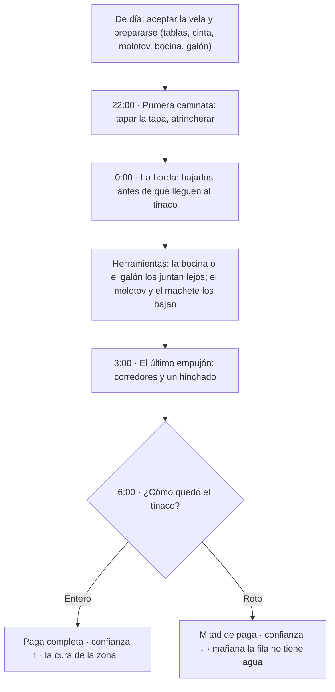

# Guadalajaja — Misiones

> La lista de misiones del juego: la del **piloto**, los **contratos de la noche**, las de **día** y las de **historia**. Documento hermano de [`docs/lore.md`](lore.md) (el mundo), [`docs/especificaciones.md`](especificaciones.md) (las mecánicas) y [`docs/personajes.md`](personajes.md) (quién las da).
>
> Última actualización: 2026-11-02

## Cómo usar este documento

| Etiqueta | Significa |
|---|---|
| ✅ **Canon** | Ya está decidido; se puede programar. |
| 💡 **Propuesta** | Idea abierta; se puede cortar o cambiar. |
| 🧱 **Ya existe** | Hay algo en el repo que se puede reusar. |

**Regla de toda misión:** dice **quién la da**, **qué se hace**, **cuánto paga**, **qué riesgo tiene** y **qué sistema reusa**. Si no reusa nada, es trabajo L y hay que pensarlo dos veces.

### Índice

- [0. El piloto: defender el tinaco comunitario](#0-el-piloto-defender-el-tinaco-comunitario)
- [1. Cómo se juegan](#1-cómo-se-juegan)
- [2. Los contratos de la noche](#2-los-contratos-de-la-noche)
- [3. Las misiones de día](#3-las-misiones-de-día)
- [4. Las misiones de historia](#4-las-misiones-de-historia)
- [5. El sistema de misiones](#5-el-sistema-de-misiones)
- [6. Cómo se agrega una misión](#6-cómo-se-agrega-una-misión)
- [7. Prioridad](#7-prioridad)
- [8. Preguntas abiertas](#8-preguntas-abiertas)

---

## 0. El piloto: defender el tinaco comunitario

✅ **La misión del piloto.** Es la que se programa primero, la que se enseña y la que decide si el juego jala. Reúne todo el núcleo: la noche, los zombis, el agua, el tinaco, los pesos y el barrio.

| | |
|---|---|
| **Nombre** | Vela del tinaco |
| **Quién la da** | La **cuadrilla** (Gabriel) o el barrio, por turnos |
| **Dónde** | El **tinaco comunitario** de un parque o baldío (Parques de Santa Mugre, La Palmada o Parques del Mosco) |
| **Cuándo** | Noche completa, hasta el amanecer |
| **Duración** | 8 minutos de juego (la noche entera) |
| **Paga** | Pesos + un galón de agua + la **ficha** sellada + confianza del barrio |
| **Riesgo** | Alto: si el tinaco se rompe, se pierde el agua del barrio |
| **Reusa** | `Zombis.gd` (director y oleadas), `Refugio.gd` (barricadas), el tinaco como objetivo de vida, `CargaCuadro` |

### La noche, en tres oleadas

1. **22:00 — la primera caminata.** Pocos zombis, lentos. Sirven de tutorial: aprende a pegar, a atrincherar y a tapar la tapa.
2. **0:00 — la horda.** Llega el grupo grande. Hay que bajarlos antes de que lleguen al tinaco: la **bocina** y el **galón** sirven para juntarlos lejos y pegarles (o quemarlos) en bola.
3. **3:00 — el último empujón.** Los más rápidos (corredores) y un hinchado. Si el jugador aguantó, el tinaco está a punto.
4. **6:00 — el amanecer.** Los zombis se caen. El barrio abre la puerta y paga.

### El tinaco

- Tiene **100 de vida** (como el jugador).
- Los zombis lo **muerden, lo empujan y lo trepan**; cada mordida baja vida.
- El jugador lo **repara** con tablas y cinta (sube vida, cuesta material).
- Si llega a **0**, el agua se riega, el barrio pierde la tanda y el jugador cobra la mitad.
- La tapa es el punto débil: hay que **cerrarla** entre oleada y oleada.

### Lo que el jugador lleva

- **Tablas y cinta** (barricadas y reparación).
- **Machete** (arma inicial).
- **Molotov** (para la horda).
- **Bocina** (los atrae a un punto lejos del tinaco para pelearlos juntos; luego explota, o no).
- **Lámpara** (para ver y para que lo vean).
- **Un galón de agua** (para beber, o de cebo: lo sueltas y se juntan a beberlo, y ahí les pegas).

### Por qué es el piloto

- Usa el **núcleo** del juego: noche, zombis, tinaco, agua y pesos.
- Es **repetible**: cada noche cambia el número de zombis y la zona.
- Es **corto**: 8 minutos.
- Es **medible**: si el jugador se divierte y aguanta, el resto del juego se sostiene.
- Es **barato**: no necesita mapa nuevo, solo el tinaco comunitario y el director de zombis.

### La ficha completa

💡 Diseño hecho con `/game-quest` (2026-11-02). Lo de arriba sigue siendo el piloto; esto le pone las herramientas, las consecuencias y lo que pasa si falla.

**Gancho:** *"El tinaco es del barrio y esta noche no lo cuida nadie. Gabriel paga, la colonia pone el agua y tú pones el machete."*

**Tipo:** repetible, de proteger. **El objetivo es uno: que ningún zombi llegue al tinaco, y eso se logra matándolos.** No tiene caminos alternativos y no le hacen falta: es el contrato que se repite cada noche, y la variedad sale de la zona, de los zombis y de cómo usa el jugador sus herramientas. Se puede tomar cada noche; cambian la zona, los zombis y el escalón del régimen.

**Quién la da:** Gabriel "el Patrón" Hinojosa (la cuadrilla), en el mercado de Los Garrafones, o el barrio de la zona, con un vecino en la fila del agua. Se acepta de día, antes de las 19:00.

**Dónde:** el tinaco comunitario de **Parques de Santa Mugre** (el del parque), **La Palmada** o **Parques del Mosco**. La zona decide cuántos zombis salen (`Zombis.maximo()` con el índice) y cuánto paga.

**Objetivos:**

1. **Prepararse de día** (obligatorio): comprar o fabricar tablas, cinta, molotov (botella + trapo + gasolina) y bocina; llevar un galón.
2. **22:00, la primera caminata** (obligatorio): pocos flacos, lentos. Enseña a pegar, a atrincherar y a **cerrar la tapa** entre oleadas.
3. **0:00, la horda** (obligatorio): el grupo grande. Hay que **bajarlos antes de que lleguen al tinaco**. Las herramientas ayudan a pelear:
   - **La bocina** los atrae a todos a un punto lejos del tinaco; ahí se pelean juntos. Luego explota (o no).
   - **El galón**, soltado de cebo, los junta a beber (beben y no se llenan, lore regla 16): un blanco quieto para el machete o el molotov.
   - **El molotov** quema a los que están juntos; **las tablas** cierran el paso y los hacen llegar por donde los esperas.
4. **3:00, el último empujón** (obligatorio): corredores y un hinchado. Si el jugador aguantó, el tinaco está a punto.
5. **6:00, el amanecer**: se cobra según cómo quedó el tinaco.

**Paga** (sin validar con el balance):

- **Pesos:** 150 (Santa Mugre), 200 (La Palmada), 250 (Parques del Mosco); +25 % por cada escalón del régimen de la zona, porque hay más riesgo. Coincide con la tabla de contratos (150-250).
- **Objetos:** 1 galón (35) y la **ficha sellada** de la cuadrilla.
- **Confianza** de la zona: sube si el tinaco queda entero; baja si se rompe.

**Qué cambia en el mundo** (lore §17, el estado del mundo):

| Resultado | Cambia |
|---|---|
| Tinaco entero | Confianza ↑; **cura ↑** (el agua llega a las casas); al otro día la fila del tinaco tiene agua y chisme |
| Tinaco roto | Confianza ↓; la fila está vacía; un bark: *"¿Y el que cuidaba?"* |

**Requiere:** nada. Es el piloto y la primera que se aprende.

**Si falla:** si el tinaco llega a 0, el agua se riega y se cobra la mitad. Si el jugador muere, pierde la paga y reaparece en el refugio (§1); el tinaco aguanta solo lo que le quede. Si abandona la vela, no cobra y la confianza baja.

**Reusa:** `Zombis.gd` (oleadas y `maximo()`), `Refugio.gd` y `EntradaRefugio.gd` (barricadas y el tinaco con vida), `Ciclo.gd` (las horas). **Falta:** los tipos corredor e hinchado (hoy solo hay `zombie_gordo`), la bocina como objeto, la lámpara (sin modelo, `items.md` §8) y el estado del mundo (lore §21).

> **Ojo:** el piloto es **una misión**, no la partida de 3 noches. La partida de 3 noches (`Partida.gd`) es un **modo reto** aparte, con su jefe (que era alguien: ver lore §8) y su tinaco del refugio. El piloto es la versión repetible y pública.

---

## 1. Cómo se juegan

- **De día** se acepta el contrato, se compra, se repara y se duerme.
- **De noche** se sale a cumplirlo; el mundo está oscuro, los zombis salen y las tiendas están cerradas.
- **Los contratos** llegan por el **celular** o por la **cuadrilla**; se aceptan antes de las 19:00.
- **La paga** es en pesos; el agua es un extra.
- **Si el jugador muere** (o se le llena la sed), pierde el botín y la paga del contrato; reaparece en el refugio.
- **Si el contrato falla** (se rompe el tinaco, se pierde el paquete, se muere el cliente), cobra la mitad o nada, y el barrio lo recuerda.

---

## 2. Los contratos de la noche

| Contrato | Quién | Qué se hace | Paga | Riesgo | Reusa | Prog. |
|---|---|---|---|---|---|---|
| **Vela** | La cuadrilla | Defender el tinaco comunitario (o uno de una casa) hasta el amanecer | Pesos + agua | Los zombis vienen por el agua | Tinaco, Refugio, Zombis | M |
| **Reparto clandestino** | La cuadrilla, un cliente | Llevar agua filtrada (ilegal) del tinaco, el pozo o la capilla al domicilio | Pesos | Los zombis y los blancos | WorldItem, Misiones | S |
| **Recolección** | La cuadrilla, un comprador | Juntar el botín de los muertos en una bodega o una calle | Pesos | Más zombis, las camadas | Botín, Zombis | S |
| **Encargo** | Una señora, el cura | Llevar algo (o a alguien) de un punto a otro | Pesos | La caminata | Seguir, Misiones | S |
| **Cacería** | La colonia, la iglesia | Bajar al zombi que se comió a alguien | Pesos/objeto | Alto | Zombis, Misiones | M |

💡 **Cuánto paga cada contrato** (sin validar con el balance; referencia: galón 35, tacos 45, botín 5-60 por zombi, botiquín 120). La noche paga el triple que el día, y la paga sube con el escalón del régimen de la zona (más riesgo, más pesos).

| Contrato | Paga | Extra |
|---|---|---|
| Vela | 150-250 | 1 galón + la ficha sellada; si cae el tinaco, la mitad |
| Reparto clandestino | 60-100 por entrega | Sube la cura de la zona |
| Recolección | 30-50 + lo que encuentres | — |
| Encargo | 40-80 | Sube la confianza |
| Cacería | 200-300 o un objeto | El oficio del zombi dice qué suelta |

### Vela

El contrato principal. Se defiende un tinaco (el comunitario o uno de una casa) desde el atardecer hasta el amanecer. La versión pulida es [el piloto](#0-el-piloto-defender-el-tinaco-comunitario).

### Reparto clandestino

El jugador lleva agua filtrada del tinaco comunitario a un cliente. Los **zombis huelen el agua** y la siguen; los **blancos** pueden clausurar la entrega. El paquete es frágil: si lo suelta, se riega.

### Recolección

El jugador entra a una **bodega abandonada** (de día) o a una calle donde cayeron muertos (de noche) a juntar pesos, herramientas y lo que traían. Las **camadas** duermen ahí: hay que entrar sin despertarlas.

### Encargo

Una vecina, el cura o la cuadrilla piden llevar algo (medicinas, una carta, un garrafón) o acompañar a alguien. La caminata puede cruzarse.

### Cacería

La colonia o la iglesia pagan por un zombi concreto: el que se comió a alguien, el que ronda una escuela. El jugador sigue las pistas, lo encuentra y lo baja. La paga es en pesos o en un objeto.

---

## 3. Las misiones de día

| Misión | Quién | Qué se hace | Paga | Reusa | Prog. |
|---|---|---|---|---|---|
| **Transportar droga** | Los Gotera | Llevar un paquete de A a B (de noche, pero se prepara de día) | Pesos/agua | Misiones | S |
| **Transportar algo** | Una tienda, una señora | Llevar un objeto frágil de día, sin correr | Pesos | Misiones | S |
| **Encontrar cosas** | Un vecino, el cura | Buscar N objetos en el mapa y volver | Objeto | WorldItem | S |
| **Corretear a alguien** | Un cliente | Alcanzar a un NPC que huye por una ruta | Pesos | NPC, Misiones | M |
| **Botarga de la Gota** | Nadie: es un disfraz | Ponerte la botarga; los NPCs te siguen y bailan | Objeto especial | `simi_botarga.scn` | S-M |
| **Tiro al blanco** | El barrio, una feria | Caguamas en una barda o patitos en una feria | Pesos/munición | Física, Misiones | S |
| **Sacar dinero de máquinas** | Nadie | Romper una maquinita sin que te vea el encargado | Pesos | `tragamonedas.gd` | S-M |
| **Manifestación** | El comité del barrio | Unirte a una marcha por el agua; llegan policías | Pesos/agua | Multitud, IA | L |
| **Rescatar sobreviviente** | Un vecino | Sacar a alguien atrapado y llevarlo al refugio | Pesos | Seguir | S |
| **Acompañar a alguien** | La cuadrilla | Llevarlo de un punto a otro sin que la caminata lo alcance | Pesos | Seguir | S |
| **Defender el puesto** | El taquero | Aguantar 2 minutos de zombis mientras cierra | Pesos/tacos | Zombis | S |
| **Muestras de agua** | El científico | Llevarle agua de 3 llaves o charcos | Objeto | WorldItem | S |
| **Limpiar una camada** | La cuadrilla | Entrar de día a una bodega y bajar a los zombis dormidos | Pesos | Zombis, Bodegas | M |
| **Carrera** | El barrio | Checkpoints por la colonia, a pie o en carrito | Pesos | Misiones | S |
| **Pintar bardas** | La cuadrilla | Grafitear N bardas marcadas | Pesos | `Calcomanias.gd` | S |
| **Cocinar tacos** | El taquero | Minijuego de pedidos en el puesto | Pesos/tacos | UI | M |
| **Buscar al perro** | Una señora | Seguir ladridos y devolver al perro | Objeto | Seguir | S |
| **Encargo de compras** | Cualquiera | Comprar una lista en el OXXO y entregarla | Pesos | Tiendas | S |
| **Cooperativas** | La cuadrilla | Una persona carga, la otra defiende | Pesos | Multijugador | M |

**Tiro al blanco**, ideas concretas: (a) caguamas vacías sobre una barda con resortera o pistola, puntos por tiempo; (b) puesto de feria con patitos; (c) zombis "de práctica" atados. La (a) es la más fácil.

---

## 4. Las misiones de historia

Son las de [La revelación](lore.md#17-la-revelación): opcionales, repartidas por el mapa, y cada una entrega una pista.

| Misión | Pista | Quién | Qué se hace |
|---|---|---|---|
| **El agua sabe distinto** | 1 | Cualquiera | Beber y comparar; no hay misión, es una observación |
| **Los zombis eran vecinos** | 2 | La maestra o la abuela | La lista de Marisol, lo que traen, los papeles raros |
| **El G-7** | 3 | El científico desertor | Encontrarlo, escucharlo y sacar los manifiestos |
| **El Decreto 47** | 4 | El empleado del palacio o Sofía | Conseguir el expediente y la hoja de conteo |
| **La presa está llena** | 5 | El cura, don Nemesio o el Güero | Ver el expediente del acueducto (la presa está llena) y descubrir que el milagro es un filtro |

Misiones de apoyo, atadas a personajes:

- **La capilla** (padre Chuy): llevar agua, reparar el filtro, defender la vigilia.
- **El cobalto** (Elena): entrar al drenaje y sacar el expediente.
- **La verdad** (Sofía): llevar las pruebas a la radio.
- **El heredero** (Gerardo): contarle lo que sabes y ver qué elige.
- **La toma** (don Nemesio): abrir la válvula (y romper el pacto) o venderle el secreto a Buenrostro.
- **El pozo** (doña Refugio y Chava): decidir de quién es el pozo.

### El registro de las misiones de historia

💡 Cada misión de historia tiene **dos caminos** y **cambia algo del estado del mundo** ([`docs/lore.md` §17](lore.md#el-estado-del-mundo)). Ninguna es obligatoria y ninguna se "termina" la historia: el que se las salta sigue jugando. Las pagas están sin validar.

| ID | Misión | Da | Zona | Camino A | Camino B | Qué cambia | Paga | Requiere |
|---|---|---|---|---|---|---|---|---|
| P0 | La vela del tinaco (piloto, repetible) | Gabriel / el barrio | Santa Mugre, La Palmada o Parques del Mosco | Matar a los zombis antes de que lleguen al tinaco | — (repetible: un solo objetivo; la bocina y el galón son herramientas) | Confianza y cura de la zona | 150-250 + galón + ficha | — |
| H1 | El agua sabe distinto | Nadie | Cualquiera | Beber de la llave y del garrafón y comparar | Preguntarle a la encargada de abarrotes | Nada: es la primera pista | — | — |
| H2 | Los zombis eran vecinos | Marisol | La Florida Marchita | Comparar su lista con un **acta de ausencia** (del Güero o de un papel raro) | Encontrar a su sobrino amarrado: ayudarla a esconderlo o bajarlo | Confianza de la zona; Marisol te da la llave de la cisterna | Agua para la escuela (o nada, si lo bajas) | Un acta de ausencia (A) |
| H3 | El G-7 | Dr. López | La Florida → El Mante Tieso | De noche, entrar a la planta con Martín (una cuota) y robar un manifiesto | De día, con la ruta de Armando, llevarle a López **muestras de agua** para que las pruebe | El manifiesto (documento); el escalón del Mante sube | 150 + la prueba del agua | — |
| H4 | El Decreto 47 | El Güero o Sofía | Parques de Santa Mugre | Comprarle al Güero las copias y la **hoja de conteo** | Entrar al archivo del palacio de noche | La hoja de conteo (sus nombres son los de la lista de Marisol); Buenrostro empieza a buscar al Güero | Copias: 200 (A) | — |
| H5 | La presa está llena | El cura, don Nemesio o el Güero | La Gotera / Los Garrafones | Que Nemesio te enseñe la válvula (te cobra un favor) | Que Chuy te confiese el filtro (si la confianza es alta) | El jugador sabe; nada cambia hasta que actúe | — | — |
| A1 | La capilla | Padre Chuy | Los Garrafones | Robar un filtro nuevo de una Puri-GelA | Comprárselo a los Gotera (y deberles) | La cura de Los Garrafones sube; el régimen contesta | Agua gratis con más cupo | — |
| A2 | El cobalto | Elena | Parques del Mosco | Bajar al drenaje de día (las camadas duermen) | Cambiarle el expediente por botas y linterna | El expediente; se marcan los postes del 84 | — | Confianza con Elena |
| A3 | La verdad | Sofía | Parques de Santa Mugre | Llevarle dos pruebas (manifiesto, hoja, expediente) | Grabar a López o a Buenrostro diciéndolo | El enojo sube **solo donde ya hay cura** | — | 2 de H3, H4, A2 |
| A4 | El heredero | Gerardo | Haciendas de San Jodido | Enseñarle los papeles: se vuelve aliado (acceso al palacio) | Callarte y usarlo: su firma te abre puertas, y él se entera después | Gerardo aliado, enemigo o víctima | Acceso | H3 o H4 |
| A5 | La toma | Don Nemesio | La Gotera | Abrir la válvula: el sureste se cura de golpe y los Gotera se vuelven contra ti | Venderle el secreto a Buenrostro: GelA sella la toma y te paga | La válvula; la cura del sureste o el escalón de toda la ciudad | Venderla: 1,000 (B) | H5 |
| A6 | El pozo | Doña Refugio y Chava | La Palmada | Convencer a Chava de quedarse (o pagarle tú la salida) | Dejarlo vender: a GelA (lo sella) o a los Gotera (lo cobran) | El pozo; el agua viva de La Palmada | Lo que pague el comprador (B) | — |

**Coherencia:** cada misión usa personajes, zonas y bandos que ya existen. Ninguna saca al Nocturno del sandbox: todas se toman de día, se juegan con sistemas de los contratos (ir a, recoger, entregar, sobrevivir) y dejan un dato del estado del mundo.

---

## 5. El sistema de misiones

✅ Se programa **una vez** y luego cada misión es casi solo datos (ver [`docs/especificaciones.md`](especificaciones.md) §6.3).

- `MisionData` (Resource `.tres`): nombre, NPC que la da, descripción, recompensa, si es de día o de noche, y una **lista de pasos**.
- Pasos reutilizables: `ir_a(punto)`, `recoger(objeto, n)`, `entregar(objeto, npc)`, `derrotar(tipo, n)`, `seguirme(npc, n)`, `sobrevivir(segundos)`, `alcanzar(npc)`, `defender(objetivo, segundos)`.
- Un gestor (autoload, como `Inventory`) lleva la misión activa, el marcador del minimapa y la flecha en pantalla.
- El **celular** muestra los contratos disponibles y las misiones activas.
- La **cuadrilla** (Gabriel) reparte los contratos de la noche; el barrio y los NPCs, las de día.

---

## 6. Cómo se agrega una misión

1. Crear `resources/misiones/<nombre>.tres` con los campos de arriba.
2. Elegir los pasos (los tipos de arriba) y el orden.
3. Poner el NPC que la da (una `Persona` de [`docs/personajes.md`](personajes.md)).
4. Poner la recompensa (pesos, agua o un objeto).
5. Probarla en `scenes/safehouse.tscn` (el refugio de pruebas) antes de meterla al mapa.
6. Si es de noche, revisar que se pueda aceptar antes de las 19:00 y que el celular la muestre.

---

## 7. Prioridad

| Orden | Qué | Por qué |
|---|---|---|
| 1 | **El piloto: vela del tinaco** | Reúne todo el núcleo y es la prueba del juego |
| 2 | **Los 5 contratos de la noche** | Es el bucle que se repite |
| 3 | **Las misiones de día fáciles** (encargo, compras, encontrar, corretear) | Dan dinero y enseñan el mapa |
| 4 | **Las de historia** | Son el motivo para explorar |
| 5 | **Las grandes** (manifestación, cooperativas) | Dependen de multijugador y de multitud |

---

## 8. Preguntas abiertas

- [ ] 💡 ¿El piloto se juega solo o ya con el celular y la cuadrilla?
- [ ] 💡 ¿El tinaco comunitario tiene vida propia o se mide por "mordidas"?
- [ ] 💡 ¿Las velas son de 8 minutos siempre o cambian según la zona?
- [ ] 💡 ¿El reparto clandestino se puede hacer de día (más seguro) o solo de noche?
- [ ] 💡 ¿La cacería da un objeto único o solo pesos?
- [ ] 💡 ¿Las misiones de historia se pueden perder para siempre?
- [ ] 💡 ¿Cuántos contratos se pueden aceptar a la vez?
- [ ] 💡 ¿El barrio recuerda los fracasos (reputación) o solo la paga?
